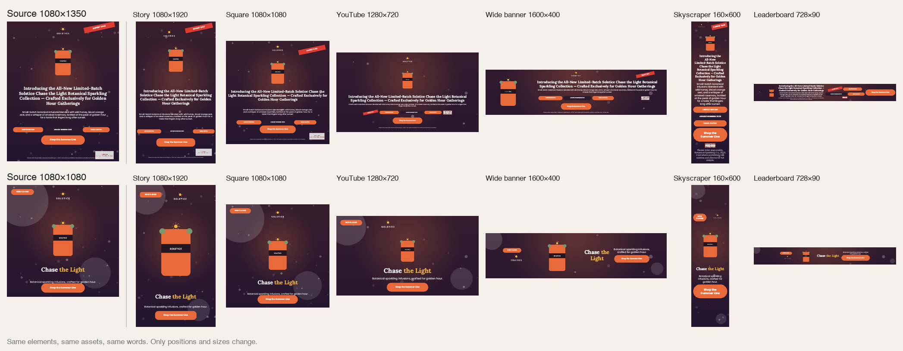
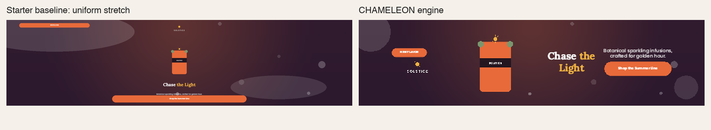
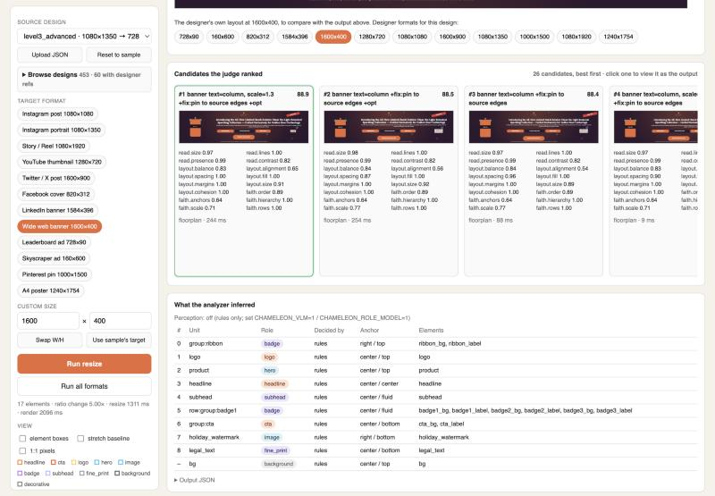
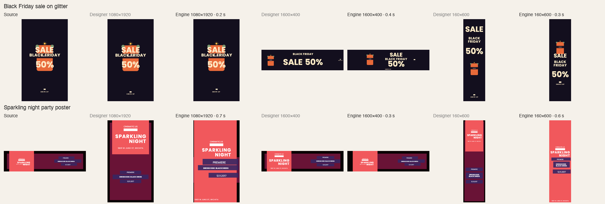
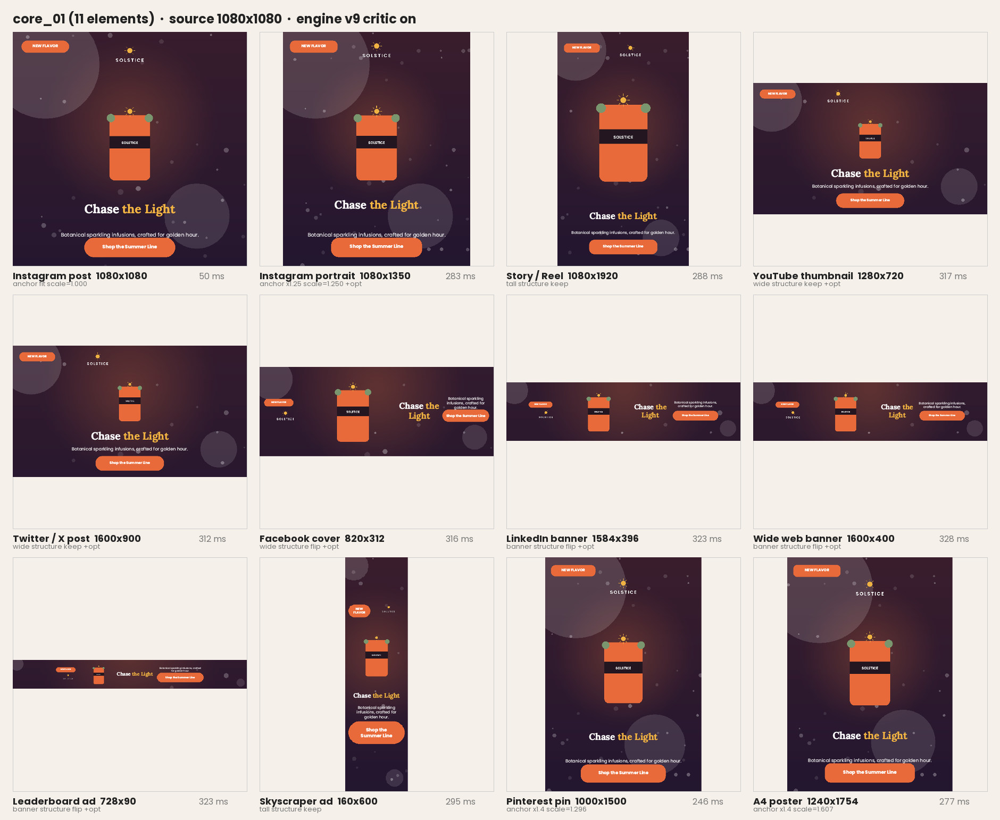
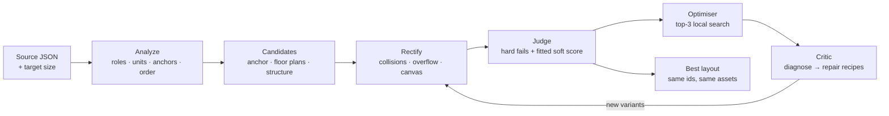

<div align="center">



# CHAMELEON

**Any design. Every canvas.**

One finished design in. The same design, re-composed for a different canvas, out.
An engine for the Adobe University Hackathon 2026 "CHAMELEON" challenge that moves the furniture instead of stretching the photo.


</div>

---

## Results

Measured on real designs, not on the three samples. The eval corpus is 453 templates from the public Crello dataset, each resized to the 12 platform formats the brief names, plus 608 cases where the template's own designer published a second size (6,058 cases). On top of that, 720 layouts were composed by hand as references (60 designs × 12 formats); 10 of those designs were sealed as a hold-out and never tuned on.

| What we measure | Engine v9 |
| --- | --- |
| Cases with any hard defect: text overflow, unwanted overlap, content off canvas, distorted image, unreadable font | **13 of 4,198 (0.31 %)** on the v9 slice; 28 of 6,058 on the last full run (v7) |
| Headline or CTA below the readable floor, on the 4,198-case slice | 23 → **13** after the critic loop |
| Headline or CTA with a contrast failure, same slice | 19 → **11** |
| Agreement with the designer's own layout, hold-out designs (0 to 1) | 0.595 → 0.603 → 0.610 → 0.614 → **0.615** across v6 · v7 · v8 · v9 · v10 |
| Adversarial synthetic corpus (2,474 cases: 45-element designs, 1×1 and 4000×4000 targets, empty text, missing assets, rotation 725°) | never crashes, every id preserved |
| Runtime per task, single process, Apple Silicon | **p50 0.3 s · p95 1.0 s** |

<table>
<tr>
<td></td>
</tr>
<tr>
<td align="center">The Level 2 sample resized to a 1600×400 web banner. Left: the starter kit's uniform stretch. Right: the engine.</td>
</tr>
</table>

---

## How it works

`resize(source, target_canvas)` gets a design as JSON (text, image and shape elements with positions, sizes, fonts and colours) and a target size, and returns the same elements with new positions and sizes. It never adds, removes or regenerates anything, never changes a word or a font family, and keeps every image's aspect ratio. Everything below is plain Python with numpy; the only model that ships is a 391 KB tree ensemble.

<table>
<tr>
<td width="50%" valign="top">

### 1. Understand the design 🔍
Element ids are opaque in the hidden tests, so roles are inferred from signals: size, position, z-order, colour, text length and casing give a headline, subhead, body, CTA, logo, hero image, badges, legal line, background and decoration. Elements that belong together become one unit: a pill with its label, a text on its plate, a row of badges, a headline with its underline. Edge anchors, reading order and importance are read off the source. A learned role classifier (gradient-boosted trees on 123 id-free features, trained on 20k designs) can vote alongside the rules.

</td>
<td width="50%"></td>
</tr>
<tr>
<td width="50%"></td>
<td width="50%" valign="top">

### 2. Compose, don't stretch 🧩
Every task gets 18 to 21 candidate layouts from three families. **Anchor** keeps the source's composition for small shape changes. **Floor plans** re-compose by the target's shape family (tall and square stack, wide puts the hero on one side, banners run one row), with every slot's size driven by one global shrink factor and per-role shrink speeds, so legal text and badges give way before the headline, logo and CTA. **Structure** keeps the source's own bands, panels and column splits and re-proportions them. Text is re-wrapped with the renderer's real glyph widths, so what we measure is what gets drawn.

</td>
</tr>
<tr>
<td width="50%" valign="top">

### 3. Judge like the rubric, then repair 📏
A deterministic rectifier removes collisions, overflow and off-canvas content at unit level. A judge then scores every candidate: hard fails (−1000 each) for anything the brief calls disqualifying, and a 0 to 100 soft score for readability, layout (balance, alignment, even spacing, fill, margins, cohesion) and faithfulness (reading order, anchors, size hierarchy). Its 16 weights were fitted on the designer references. The top three are refined by a local search over a design-principle energy, and a critic loop reads what the judge still dislikes, maps it to a repair recipe (raise the CTA to its floor, put the headline back on its plate, pin the logo to its corner, keep the badges in a row) and regenerates targeted variants. The background is read as a composition too: a text-less render becomes a map of light, glow and busyness, each text keeps its relation to that map (on the glow, on the quiet part of the picture) rather than its coordinates, and decorative shapes move as one arrangement (corners, diagonal, mirrored) instead of one by one. Best candidate wins.

</td>
<td width="50%"></td>
</tr>
</table>



### Designers as the ground truth

The scorer was first built from rules, and it rejected designer work: when 240 hand-composed layouts were run through it, 61 tripped a hard fail, mostly text deliberately layered over a photo or a panel. So the references became the target. A small declarative DSL ([`tools/designer_dsl.py`](chameleon/tools/designer_dsl.py)) turns a grid-and-slots spec into schema-valid JSON, and 60 designs were composed by hand in all 12 formats ([`docs/designer/GUIDELINES.md`](docs/designer/GUIDELINES.md) is the brief those compositions followed). They are used three ways: to fix the scorer's rules until the references pass (61 → 10 hard fails, the rest being deliberate bleed the brief allows), to fit the judge's weights by pairwise logistic regression on reference-versus-candidate pairs, and to measure the engine with a designer-agreement metric (position, size, reading order and hierarchy against the reference). The 10 hold-out designs are reported separately in every evaluation and were never fitted on.

### Robust by construction

Every change is re-run through the harness before it stays in: the 6,058 real cases, a seeded synthetic corpus of 2,474 adversarial designs, and metamorphic tests that assert the output does not change when element ids are renamed, when the element list is shuffled, or when a group is translated. The sample tasks are regression fixtures with byte-identical goldens. Nothing is tuned to a design or a size; the eval design ids appear in the code only as test cases.

### What we tried and what we shipped

- **A vision-language model as the judge.** Qwen3-VL 4B, quantised, running on CPU through llama.cpp, was benchmarked as a pairwise judge and as a perceiver of roles. As a judge it reached 60 % accuracy at 24 s per pair; models of 2B and under were position-locked. As a perceiver it agreed with labelled roles less often than the rules (0.69 vs 0.71) while the learned classifier reached 0.83. The adapter is shipped and off ([`docs/S1_PERCEPTION.md`](docs/S1_PERCEPTION.md), [`docs/VLM_BENCH.md`](docs/VLM_BENCH.md)).
- **A learned ranker instead of a linear judge.** Gradient-boosted and extended linear rankers over the score breakdown were fitted on the references. None beat the 16-weight linear judge on the hold-out; the trees over-fit the tuning designs. The linear judge shipped ([`docs/EVAL_V8.md`](docs/EVAL_V8.md)).
- **A relational energy optimiser.** O'Donovan-style preservation terms (alignment groups, proximity, containment, symmetry, reading order) plus aesthetic terms, with weights fitted on PRISM-style one-principle perturbations of the references. Gains were real but small, so it runs on the top three candidates only ([`docs/EVAL_V7.md`](docs/EVAL_V7.md)).
- **A critic loop.** The judge's diagnosis fed back into generation as repair recipes. Winners with a hard fail fell from 42 to 24 on the eval slice with no new failures, at +0.015 s per task. On by default ([`docs/CRITIC_LOOP.md`](docs/CRITIC_LOOP.md)).

### Playing by the rules

Everything the brief lists as disqualifying is a hard fail in the judge and a check in the tests: the output holds exactly the source's element ids, text content and font families are untouched, images keep their aspect ratio, nothing important leaves the canvas (low-opacity decorative bleed is allowed, as the Level 2 sample intends), and no asset is regenerated, redrawn or replaced. The engine runs offline, the judge's pixel checks are a bonus signal and never a dependency, and a uniform-scale safety net guarantees a valid layout even if the renderer is unavailable.

---

## Quick start

**You need:** Python 3.11 and git. Everything runs from the [`chameleon/`](chameleon) folder.

```bash
cd chameleon
python3.11 -m venv .venv && .venv/bin/pip install -r requirements.txt
.venv/bin/python -m engine.main
```

This resizes every task in `input/` (the three sample levels are there) and writes `output/<task>_output.json` and `.png`, then runs a self-check.

### Docker, the way stage one is scored

```bash
cd chameleon
docker build --platform linux/amd64 -t my-chameleon-engine .
docker run --rm --network none \
  -v $(pwd)/input:/app/input \
  -v $(pwd)/output:/app/output \
  my-chameleon-engine
```

> [!NOTE]
> - The build also bakes the Qwen3-VL weights (2.8 GB) so the optional VLM path can run offline; the engine never loads them unless `CHAMELEON_VLM=1`.
> - On Apple Silicon the `linux/amd64` image needs Rosetta: skia, inside the organisers' own renderer, segfaults under QEMU. A native `linux/arm64` build of the same Dockerfile runs the three samples in 4 s ([`docs/DOCKER_CHECK.md`](docs/DOCKER_CHECK.md)).

### Flags

All default to the shipped behaviour; each `=0` switch is byte-identical to the stage before that feature.

| Variable | Default | What it does |
| --- | --- | --- |
| `CHAMELEON_OPTIMIZE` | `1` | local-search refinement of the top three candidates |
| `CHAMELEON_CRITIC` | `1` | diagnose-and-repair rounds after judging |
| `CHAMELEON_BACKGROUND` | `1` | backdrop-aware text placement and decoration patterns |
| `CHAMELEON_ROLE_MODEL` | `0` | learned role classifier votes with the rules |
| `CHAMELEON_VLM` | `0` | vision-language perception (needs the baked weights) |
| `CHAMELEON_RENDER` | auto | pixel checks in the judge; off automatically under emulation |
| `CHAMELEON_DUMP_DIR` | unset | write every judged candidate's JSON, PNG and scores |

## Playground

A local UI to run the engine on anything and see why it chose what it chose: source, stretch baseline and output renders, every judged candidate with its score breakdown, the inferred roles, a design browser over the 453 eval designs with the designer's own version beside the output, and an eval browser over every harness run.

```bash
cd chameleon && .venv/bin/python tools/playground.py
```

Then open [localhost:8765](http://localhost:8765) (eval browser at `/eval`, A/B labelling at `/label`).

## Tests and evaluation

```bash
cd chameleon
.venv/bin/pip install pytest
.venv/bin/python -m pytest tests -q                      # 464 tests, about 4 min
.venv/bin/python -m eval.run_eval --limit 20              # smoke run of the harness
.venv/bin/python -m eval.run_eval --synthetic 200 --seed 1 --workers 4 --name synth
```

The Crello slice downloads on first use (`.venv/bin/python -m eval.crello_convert --target 450`, about 1 MB of metadata; images are replaced by the brand kit's assets, so the engine is judged on layout, not on the photos).

## What's inside

| Folder | What it does |
| --- | --- |
| [`chameleon/engine/`](chameleon/engine) | The engine. `resize.py` orchestrates `analyze` → `candidates` (`relayout`, `floorplan`, `structure`) → `rectify` → `score` → `optimize` → `critic`; `textfit` mirrors the renderer's wrapping; `contrast` estimates WCAG contrast from the JSON; `backdrop` and `patterns` read the background as a composition; `role_model` is the shipped classifier |
| [`chameleon/eval/`](chameleon/eval) | Harness: Crello conversion, 6k-case runs, metrics, synthetic corpus, calibration, reports |
| [`chameleon/tools/`](chameleon/tools) | Playground, designer DSL and comparison, role-model training |
| [`chameleon/tests/`](chameleon/tests) | Unit, golden, metamorphic and judge-loop tests |
| [`docs/`](docs) | Every milestone's write-up with numbers and renders: `EVAL_V1` to `EVAL_V8`, `CRITIC_LOOP`, `EVAL_SYNTH`, `ROLE_MODEL`, `VLM_BENCH`, `DOCKER_CHECK`; the designer references under `designer/` and `designer2/` |

`chameleon/` started from the organisers' starter kit ([jhaaj08/chameleon](https://github.com/jhaaj08/chameleon)); only `engine/`, `requirements.txt` and the `Dockerfile` ship.

**Where this goes next:** [`docs/NEXT_STEPS.md`](docs/NEXT_STEPS.md) lists the freeze checklist, the five engine ideas with the most expected gain, and the approaches already measured and set aside.

## Team

Built by **Gaurav Shrivastava**, **Pranay Joshi**, and **Kavya Gupta**.
