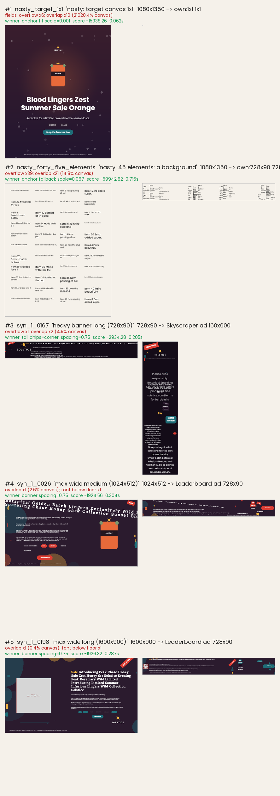
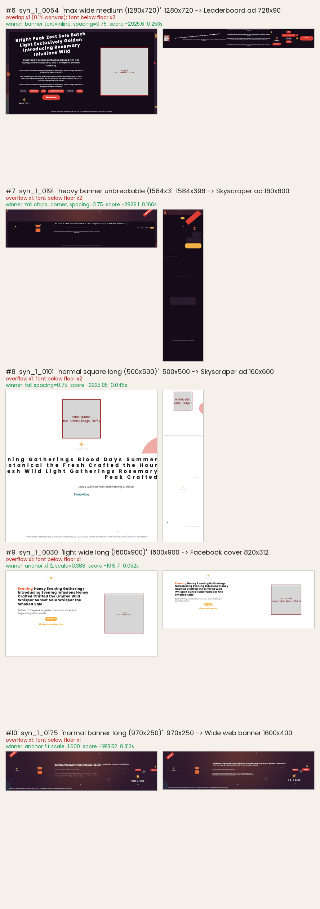
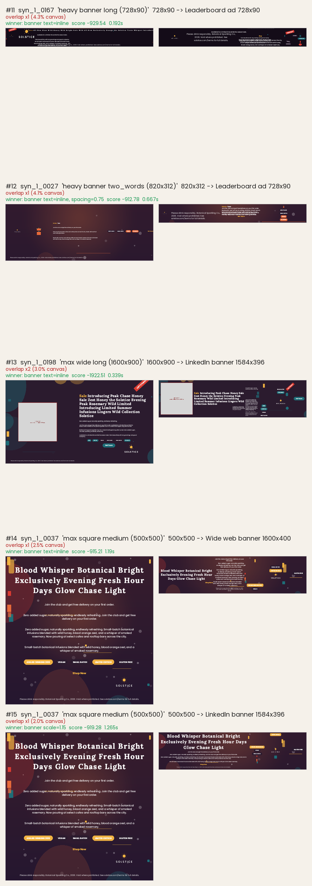
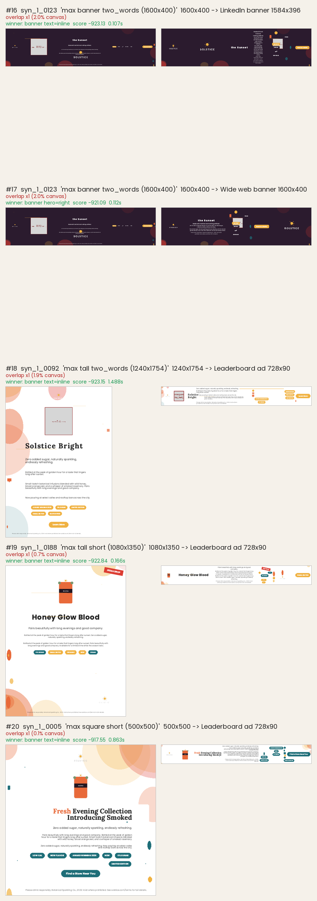
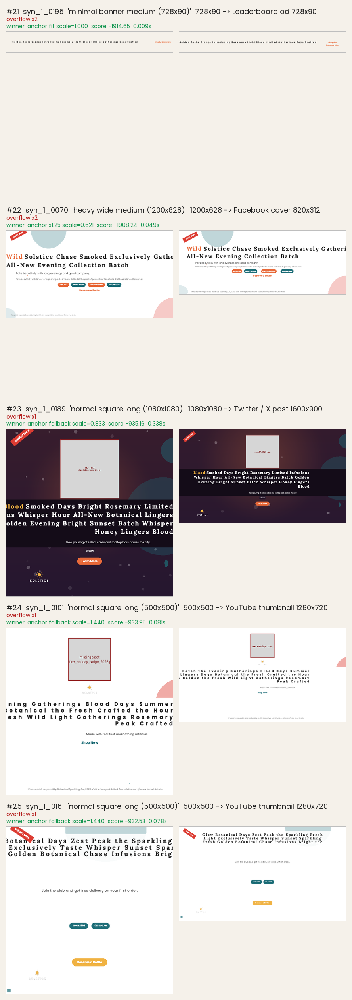
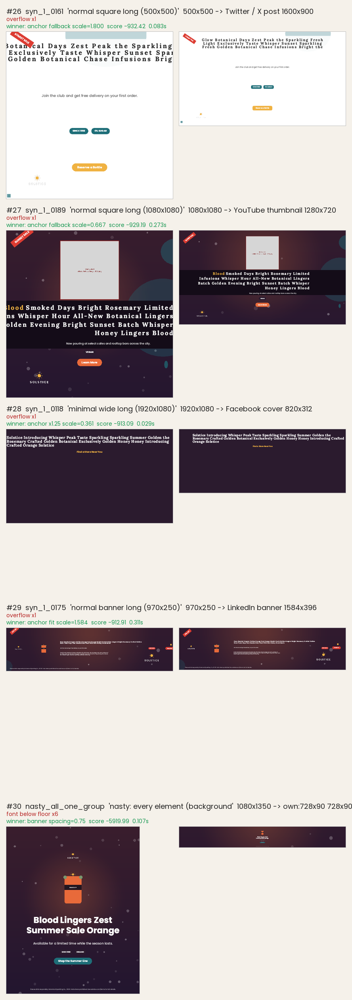

# EVAL SYNTH — the engine on adversarial synthetic designs

Generated 2026-10-23 by `eval/synth_report.py` from run `synth` (`eval/data/runs/synth`).

Harness: `eval/synth.py` (seeded generator + nasty cases), `eval/run_eval.py --synthetic N --seed S` (same metrics as the Crello run, `eval/metrics.py`), `tests/test_metamorphic.py` (metamorphic relations over `resize()`), this report.

What the corpus contains: canvases in all four ratio families, 2-45 elements, image / shape / no background, text panels, logo in any corner or the centre, hero present / absent / with a missing asset, headlines from two words to 140+ characters including unbreakable words, 0-4 subheads, CTA as free text or shape+label group (badge-style insets), 0-6 badges in rows, rotated ribbons / badges / headlines (5-45 deg), decorative ellipses (opacity 0.1-0.5) bleeding off canvas, letter spacing, line height, style_runs, max_lines, text_align, z-index ties, tiny elements, near-duplicate shadow headlines; plus the nasty cases listed below with their own targets.

Caveat: the same measurement caveats as EVAL_V1 (contrast fails are reported, not counted). The sources are generated, not designed: a few are deliberately overfull or carry an unbreakable word wider than the canvas (`src_overfull`, `src_overflow` in the tables), which no engine can lay out cleanly; they are kept because the hidden set promises such input.

## Metamorphic tests (`tests/test_metamorphic.py`)

Run of 2026-10-23 (engine snapshot of 14:18, rendering off): **149 passed, 8 xfailed, 31 xpassed** in 19 s
(`.venv/bin/python -m pytest tests/test_metamorphic.py -q -rxX`).

| relation / check | result |
|---|---|
| contract on 12 corpus designs x 4 targets (ids, order, immutables, aspect, on canvas, text boxes >= 1 px) | 48/48 pass |
| contract on the 3 samples at 300x250, 160x600, 2000x2000, 1080x1080 | 3/3 pass |
| never crash on 29 nasty cases (87 resize calls), structural contract | 27/29 pass; xfail `required_fields_only` (background without `fit` stretched, aspect +25 %), `target_1x1` (negative width/height) |
| nasty cases keep important things on canvas (18 cases) | 17/18 pass (same `required_fields_only`) |
| nasty cases never reach the uniform-scale safety net | pass |
| deterministic across two runs | 12/12 pass |
| ids are opaque (renaming ids + group ids -> identical geometry) | 12/12 pass |
| element order does not matter (shuffle -> same output per id) | 12/12 pass |
| group translation keeps the group's internal layout | 12/12 pass (one grouped unit per design) |
| identity (same canvas -> centres within 3 % of the diagonal, sizes within 30 %) | 11/12 (xfail `banner-11`: identity candidate hard-failed because the source's badge label is under the CTA floor; a floor plan re-lays out the banner) |
| +3 % width -> centres within 4 %, sizes within 30 % | 12/12 (relation marked xfail; all XPASS on this snapshot) |
| 2x source scale -> same output within 1 % / 3 % / 1.5 px font | 8/12 (xfail `square-13`, `wide-11`, `banner-11`, `banner-13`: roles depend on absolute source px, plan variant or fonts differ) |
| aggregate pass-rate floor (identity, +3 %, 2x scale >= 50 %) | pass |

Earlier the same day (engine snapshot of 14:05) identity failed on 3/12 and +3 % on 3/12 designs; the
sibling session's source-relative font floor fixed two of them. The xfail markers are non-strict so the
suite keeps passing as the engine improves; the aggregate test is the regression guard.

## Summary (random corpus, nasty cases excluded)

Cases: **2400** (200 designs; 2400 preset cases, 0 ground-truth cases)

### Failure rate by metric

| metric | cases | rate |
|---|---:|---:|
| any_defect | 189 | 7.9% |
| error | 0 | 0.0% |
| ids | 0 | 0.0% |
| fields | 0 | 0.0% |
| offcanvas | 0 | 0.0% |
| aspect | 0 | 0.0% |
| overflow | 15 | 0.6% |
| below_floor | 166 | 6.9% |
| overlap | 16 | 0.7% |
| judge_hard | 189 | 7.9% |
| judge_contrast | 0 | 0.0% |
| fallback | 12 | 0.5% |

### By source ratio family

| group | n | any defect | off-canvas | overflow | overlap | below floor | aspect | error | contrast (judge) | score mean | p50 s |
|---|---:|---:|---:|---:|---:|---:|---:|---:|---:|---:|---:|
| banner | 600 | 13.5% | 0.0% | 0.8% | 1.0% | 12.2% | 0.0% | 0.0% | 0.0% | -104.98 | 0.15 |
| square | 600 | 9.2% | 0.0% | 1.2% | 0.5% | 7.7% | 0.0% | 0.0% | 0.0% | -70.49 | 0.13 |
| tall | 600 | 3.3% | 0.0% | 0.0% | 0.3% | 3.0% | 0.0% | 0.0% | 0.0% | 48.42 | 0.13 |
| wide | 600 | 5.5% | 0.0% | 0.5% | 0.8% | 4.8% | 0.0% | 0.0% | 0.0% | -5.45 | 0.13 |

### By target family

| group | n | any defect | off-canvas | overflow | overlap | below floor | aspect | error | contrast (judge) | score mean | p50 s |
|---|---:|---:|---:|---:|---:|---:|---:|---:|---:|---:|---:|
| banner | 600 | 8.8% | 0.0% | 0.5% | 2.3% | 6.7% | 0.0% | 0.0% | 0.0% | -39.29 | 0.15 |
| square | 200 | 4.5% | 0.0% | 0.0% | 0.0% | 4.5% | 0.0% | 0.0% | 0.0% | 16.13 | 0.14 |
| tall | 1000 | 8.9% | 0.0% | 0.3% | 0.2% | 8.7% | 0.0% | 0.0% | 0.0% | -60.66 | 0.14 |
| wide | 600 | 6.3% | 0.0% | 1.5% | 0.0% | 5.0% | 0.0% | 0.0% | 0.0% | 2.52 | 0.11 |

### By source -> target family

| group | n | any defect | off-canvas | overflow | overlap | below floor | aspect | error | contrast (judge) | score mean | p50 s |
|---|---:|---:|---:|---:|---:|---:|---:|---:|---:|---:|---:|
| banner->banner | 150 | 10.7% | 0.0% | 2.0% | 3.3% | 6.0% | 0.0% | 0.0% | 0.0% | -35.19 | 0.15 |
| banner->square | 50 | 12.0% | 0.0% | 0.0% | 0.0% | 12.0% | 0.0% | 0.0% | 0.0% | -78.41 | 0.18 |
| banner->tall | 250 | 18.4% | 0.0% | 0.8% | 0.4% | 18.0% | 0.0% | 0.0% | 0.0% | -200.11 | 0.16 |
| banner->wide | 150 | 8.7% | 0.0% | 0.0% | 0.0% | 8.7% | 0.0% | 0.0% | 0.0% | -25.06 | 0.13 |
| square->banner | 150 | 12.0% | 0.0% | 0.0% | 2.0% | 10.0% | 0.0% | 0.0% | 0.0% | -104.07 | 0.14 |
| square->square | 50 | 6.0% | 0.0% | 0.0% | 0.0% | 6.0% | 0.0% | 0.0% | 0.0% | -30.74 | 0.12 |
| square->tall | 250 | 8.8% | 0.0% | 0.4% | 0.0% | 8.8% | 0.0% | 0.0% | 0.0% | -86.12 | 0.13 |
| square->wide | 150 | 8.0% | 0.0% | 4.0% | 0.0% | 4.0% | 0.0% | 0.0% | 0.0% | -24.11 | 0.11 |
| tall->banner | 150 | 5.3% | 0.0% | 0.0% | 1.3% | 4.0% | 0.0% | 0.0% | 0.0% | 24.29 | 0.14 |
| tall->square | 50 | 0.0% | 0.0% | 0.0% | 0.0% | 0.0% | 0.0% | 0.0% | 0.0% | 88.92 | 0.14 |
| tall->tall | 250 | 2.8% | 0.0% | 0.0% | 0.0% | 2.8% | 0.0% | 0.0% | 0.0% | 52.87 | 0.12 |
| tall->wide | 150 | 3.3% | 0.0% | 0.0% | 0.0% | 3.3% | 0.0% | 0.0% | 0.0% | 51.62 | 0.12 |
| wide->banner | 150 | 7.3% | 0.0% | 0.0% | 2.7% | 6.7% | 0.0% | 0.0% | 0.0% | -42.21 | 0.17 |
| wide->square | 50 | 0.0% | 0.0% | 0.0% | 0.0% | 0.0% | 0.0% | 0.0% | 0.0% | 84.74 | 0.15 |
| wide->tall | 250 | 5.6% | 0.0% | 0.0% | 0.4% | 5.2% | 0.0% | 0.0% | 0.0% | -9.29 | 0.14 |
| wide->wide | 150 | 5.3% | 0.0% | 2.0% | 0.0% | 4.0% | 0.0% | 0.0% | 0.0% | 7.62 | 0.10 |

### By preset

| group | n | any defect | off-canvas | overflow | overlap | below floor | aspect | error | contrast (judge) | score mean | p50 s |
|---|---:|---:|---:|---:|---:|---:|---:|---:|---:|---:|---:|
| A4 poster | 200 | 5.0% | 0.0% | 0.0% | 0.0% | 5.0% | 0.0% | 0.0% | 0.0% | 0.62 | 0.16 |
| Facebook cover | 200 | 12.5% | 0.0% | 1.5% | 0.0% | 11.5% | 0.0% | 0.0% | 0.0% | -96.61 | 0.09 |
| Instagram portrait | 200 | 4.0% | 0.0% | 0.0% | 0.0% | 4.0% | 0.0% | 0.0% | 0.0% | 26.12 | 0.14 |
| Instagram post | 200 | 4.5% | 0.0% | 0.0% | 0.0% | 4.5% | 0.0% | 0.0% | 0.0% | 16.13 | 0.14 |
| Leaderboard ad | 200 | 13.0% | 0.0% | 0.5% | 4.5% | 9.5% | 0.0% | 0.0% | 0.0% | -86.80 | 0.12 |
| LinkedIn banner | 200 | 6.0% | 0.0% | 0.5% | 1.5% | 4.0% | 0.0% | 0.0% | 0.0% | -5.45 | 0.18 |
| Pinterest pin | 200 | 7.0% | 0.0% | 0.0% | 0.0% | 7.0% | 0.0% | 0.0% | 0.0% | -34.26 | 0.14 |
| Skyscraper ad | 200 | 21.0% | 0.0% | 1.5% | 1.0% | 20.0% | 0.0% | 0.0% | 0.0% | -260.00 | 0.08 |
| Story / Reel | 200 | 7.5% | 0.0% | 0.0% | 0.0% | 7.5% | 0.0% | 0.0% | 0.0% | -35.80 | 0.15 |
| Twitter / X post | 200 | 3.0% | 0.0% | 1.5% | 0.0% | 1.5% | 0.0% | 0.0% | 0.0% | 54.69 | 0.13 |
| Wide web banner | 200 | 7.5% | 0.0% | 0.5% | 1.0% | 6.5% | 0.0% | 0.0% | 0.0% | -25.63 | 0.18 |
| YouTube thumbnail | 200 | 3.5% | 0.0% | 1.5% | 0.0% | 2.0% | 0.0% | 0.0% | 0.0% | 49.47 | 0.12 |

### Runtime per case (s)

| p50 | p95 | max | mean |
|---:|---:|---:|---:|
| 0.13 | 0.42 | 1.74 | 0.18 |

### Strategy share / winners

| strategy | share |
|---|---:|
| floorplan | 74.7% |
| anchor | 25.3% |

| winner | cases |
|---|---:|
| tall scale=1.15 | 202 |
| wide hero=stack | 118 |
| banner scale=1.15 | 117 |
| tall chips=corner | 107 |
| banner spacing=0.75 | 103 |
| wide default | 103 |
| tall chips=corner, spacing=0.75 | 99 |
| anchor fit scale=1.000 | 86 |
| tall spacing=1.3 | 85 |
| banner text=inline, spacing=0.75 | 79 |
| wide chips=corner | 69 |
| banner default | 64 |
| tall spacing=0.75 | 63 |
| banner text=inline | 60 |
| banner spacing=1.3 | 60 |

### Judge score

| mean | p10 | p50 | p90 |
|---:|---:|---:|---:|
| -33.13 | 74.52 | 84.72 | 90.95 |

| component | mean (0-1) |
|---|---:|
| faith.anchors | 0.56 |
| faith.hierarchy | 0.96 |
| faith.order | 0.87 |
| faith.scale | 0.66 |
| layout.alignment | 0.62 |
| layout.balance | 0.91 |
| layout.fill | 0.95 |
| layout.margins | 0.87 |
| layout.spacing | 0.70 |
| read.contrast | 0.86 |
| read.lines | 0.94 |
| read.presence | 0.90 |
| read.size | 0.91 |

### Judge hard fails (winner), most common

| message (normalised) | cases |
|---|---:|
| eNaefc headline font N below readable N | 12 |
| eNced headline font N below readable N | 10 |
| ebNdNb cta font N below readable N | 10 |
| eNeNbN headline font N below readable N | 10 |
| eNdfNb headline font N below readable N | 10 |
| efNdNe cta font N below readable N | 10 |
| eNdNbdN headline font N below readable N | 10 |
| eNeNc cta font N below readable N | 9 |
| eNbNaN headline font N below readable N | 8 |
| eNfccNe cta font N below readable N | 8 |
| eNdc headline font N below readable N | 7 |
| eN cta font N below readable N | 7 |

Smallest font in the output: p05 = 5.00px, p50 = 11.00px

## Defect rate by generator property

Rates are per case (design x target). Sorted by any-defect rate within each table.

#### Element count (`n_elements_bucket`)

| value | cases | any defect | error | off-canvas | overflow | overlap | below floor | aspect | fields | contrast (judge) | score mean |
|---|---:|---:|---:|---:|---:|---:|---:|---:|---:|---:|---:|
| 31-45 | 240 | 12.1% | 0.0% | 0.0% | 0.0% | 5.4% | 7.9% | 0.0% | 0.0% | 0.0% | -100.7 |
| 02-04 | 228 | 11.0% | 0.0% | 0.0% | 0.9% | 0.0% | 10.1% | 0.0% | 0.0% | 0.0% | -58.9 |
| 11-20 | 1116 | 7.5% | 0.0% | 0.0% | 0.6% | 0.1% | 6.9% | 0.0% | 0.0% | 0.0% | -38.6 |
| 05-10 | 564 | 6.9% | 0.0% | 0.0% | 0.7% | 0.0% | 6.6% | 0.0% | 0.0% | 0.0% | -6.5 |
| 21-30 | 252 | 4.8% | 0.0% | 0.0% | 0.8% | 0.8% | 4.0% | 0.0% | 0.0% | 0.0% | 19.3 |

#### Headline length class (`headline_len`)

| value | cases | any defect | error | off-canvas | overflow | overlap | below floor | aspect | fields | contrast (judge) | score mean |
|---|---:|---:|---:|---:|---:|---:|---:|---:|---:|---:|---:|
| long | 384 | 25.0% | 0.0% | 0.0% | 3.1% | 1.3% | 21.9% | 0.0% | 0.0% | 0.0% | -300.8 |
| medium | 624 | 8.3% | 0.0% | 0.0% | 0.3% | 0.6% | 7.7% | 0.0% | 0.0% | 0.0% | -50.4 |
| unbreakable | 228 | 8.3% | 0.0% | 0.0% | 0.4% | 0.0% | 8.3% | 0.0% | 0.0% | 0.0% | -34.1 |
| two_words | 432 | 2.8% | 0.0% | 0.0% | 0.0% | 1.2% | 1.6% | 0.0% | 0.0% | 0.0% | 55.0 |
| short | 732 | 1.4% | 0.0% | 0.0% | 0.0% | 0.3% | 1.1% | 0.0% | 0.0% | 0.0% | 70.3 |

#### Source ratio family (`family`)

| value | cases | any defect | error | off-canvas | overflow | overlap | below floor | aspect | fields | contrast (judge) | score mean |
|---|---:|---:|---:|---:|---:|---:|---:|---:|---:|---:|---:|
| banner | 600 | 13.5% | 0.0% | 0.0% | 0.8% | 1.0% | 12.2% | 0.0% | 0.0% | 0.0% | -105.0 |
| square | 600 | 9.2% | 0.0% | 0.0% | 1.2% | 0.5% | 7.7% | 0.0% | 0.0% | 0.0% | -70.5 |
| wide | 600 | 5.5% | 0.0% | 0.0% | 0.5% | 0.8% | 4.8% | 0.0% | 0.0% | 0.0% | -5.5 |
| tall | 600 | 3.3% | 0.0% | 0.0% | 0.0% | 0.3% | 3.0% | 0.0% | 0.0% | 0.0% | 48.4 |

#### Hero asset missing (`has_missing_asset`)

| value | cases | any defect | error | off-canvas | overflow | overlap | below floor | aspect | fields | contrast (judge) | score mean |
|---|---:|---:|---:|---:|---:|---:|---:|---:|---:|---:|---:|
| True | 504 | 11.1% | 0.0% | 0.0% | 1.2% | 1.6% | 9.1% | 0.0% | 0.0% | 0.0% | -100.4 |
| False | 1896 | 7.0% | 0.0% | 0.0% | 0.5% | 0.4% | 6.3% | 0.0% | 0.0% | 0.0% | -15.2 |

#### Any rotated element (ribbon / badge / headline) (`rotated`)

| value | cases | any defect | error | off-canvas | overflow | overlap | below floor | aspect | fields | contrast (judge) | score mean |
|---|---:|---:|---:|---:|---:|---:|---:|---:|---:|---:|---:|
| True | 876 | 11.0% | 0.0% | 0.0% | 1.0% | 1.3% | 9.4% | 0.0% | 0.0% | 0.0% | -96.4 |
| False | 1524 | 6.1% | 0.0% | 0.0% | 0.4% | 0.3% | 5.5% | 0.0% | 0.0% | 0.0% | 3.2 |

#### Rotated text (`has_rotated_text`)

| value | cases | any defect | error | off-canvas | overflow | overlap | below floor | aspect | fields | contrast (judge) | score mean |
|---|---:|---:|---:|---:|---:|---:|---:|---:|---:|---:|---:|
| True | 840 | 11.4% | 0.0% | 0.0% | 1.1% | 1.3% | 9.8% | 0.0% | 0.0% | 0.0% | -104.2 |
| False | 1560 | 6.0% | 0.0% | 0.0% | 0.4% | 0.3% | 5.4% | 0.0% | 0.0% | 0.0% | 5.1 |

#### Background kind (`background`)

| value | cases | any defect | error | off-canvas | overflow | overlap | below floor | aspect | fields | contrast (judge) | score mean |
|---|---:|---:|---:|---:|---:|---:|---:|---:|---:|---:|---:|
| image | 624 | 10.7% | 0.0% | 0.0% | 1.0% | 0.8% | 9.5% | 0.0% | 0.0% | 0.0% | -74.6 |
| none | 852 | 8.0% | 0.0% | 0.0% | 0.8% | 0.4% | 7.0% | 0.0% | 0.0% | 0.0% | -29.0 |
| shape | 924 | 5.8% | 0.0% | 0.0% | 0.2% | 0.9% | 5.1% | 0.0% | 0.0% | 0.0% | -8.9 |

#### Text on a panel shape (`panel`)

| value | cases | any defect | error | off-canvas | overflow | overlap | below floor | aspect | fields | contrast (judge) | score mean |
|---|---:|---:|---:|---:|---:|---:|---:|---:|---:|---:|---:|
| True | 600 | 10.8% | 0.0% | 0.0% | 1.5% | 0.7% | 9.3% | 0.0% | 0.0% | 0.0% | -93.3 |
| False | 1800 | 6.9% | 0.0% | 0.0% | 0.3% | 0.7% | 6.1% | 0.0% | 0.0% | 0.0% | -13.1 |

#### Theme (`theme`)

| value | cases | any defect | error | off-canvas | overflow | overlap | below floor | aspect | fields | contrast (judge) | score mean |
|---|---:|---:|---:|---:|---:|---:|---:|---:|---:|---:|---:|
| dark | 1236 | 8.0% | 0.0% | 0.0% | 0.6% | 1.1% | 6.9% | 0.0% | 0.0% | 0.0% | -37.2 |
| light | 1164 | 7.7% | 0.0% | 0.0% | 0.7% | 0.3% | 7.0% | 0.0% | 0.0% | 0.0% | -28.9 |

#### Logo position (`logo_pos`)

| value | cases | any defect | error | off-canvas | overflow | overlap | below floor | aspect | fields | contrast (judge) | score mean |
|---|---:|---:|---:|---:|---:|---:|---:|---:|---:|---:|---:|
| bl | 336 | 12.5% | 0.0% | 0.0% | 1.5% | 0.9% | 10.7% | 0.0% | 0.0% | 0.0% | -125.0 |
| br | 360 | 12.2% | 0.0% | 0.0% | 0.6% | 1.7% | 10.6% | 0.0% | 0.0% | 0.0% | -94.6 |
| c | 192 | 10.4% | 0.0% | 0.0% | 2.1% | 0.0% | 9.4% | 0.0% | 0.0% | 0.0% | -93.6 |
| bc | 228 | 9.6% | 0.0% | 0.0% | 0.0% | 1.3% | 8.3% | 0.0% | 0.0% | 0.0% | -39.2 |
| None | 516 | 9.1% | 0.0% | 0.0% | 0.6% | 0.2% | 8.5% | 0.0% | 0.0% | 0.0% | -51.2 |
| tr | 216 | 2.3% | 0.0% | 0.0% | 0.5% | 0.0% | 2.3% | 0.0% | 0.0% | 0.0% | 52.2 |
| tc | 300 | 1.7% | 0.0% | 0.0% | 0.0% | 0.7% | 1.0% | 0.0% | 0.0% | 0.0% | 70.0 |
| tl | 252 | 1.6% | 0.0% | 0.0% | 0.0% | 0.4% | 1.2% | 0.0% | 0.0% | 0.0% | 69.7 |

#### Hero (`hero`)

| value | cases | any defect | error | off-canvas | overflow | overlap | below floor | aspect | fields | contrast (judge) | score mean |
|---|---:|---:|---:|---:|---:|---:|---:|---:|---:|---:|---:|
| missing_asset | 504 | 11.1% | 0.0% | 0.0% | 1.2% | 1.6% | 9.1% | 0.0% | 0.0% | 0.0% | -100.4 |
| none | 648 | 7.4% | 0.0% | 0.0% | 0.8% | 0.3% | 6.3% | 0.0% | 0.0% | 0.0% | -24.9 |
| present | 1248 | 6.8% | 0.0% | 0.0% | 0.3% | 0.5% | 6.3% | 0.0% | 0.0% | 0.0% | -10.3 |

#### CTA kind (`cta`)

| value | cases | any defect | error | off-canvas | overflow | overlap | below floor | aspect | fields | contrast (judge) | score mean |
|---|---:|---:|---:|---:|---:|---:|---:|---:|---:|---:|---:|
| text | 660 | 9.5% | 0.0% | 0.0% | 1.2% | 0.8% | 8.0% | 0.0% | 0.0% | 0.0% | -50.3 |
| group_inset | 708 | 9.0% | 0.0% | 0.0% | 0.8% | 1.1% | 7.5% | 0.0% | 0.0% | 0.0% | -63.5 |
| group | 864 | 6.5% | 0.0% | 0.0% | 0.0% | 0.2% | 6.4% | 0.0% | 0.0% | 0.0% | -8.7 |
| none | 168 | 3.6% | 0.0% | 0.0% | 0.6% | 0.6% | 3.0% | 0.0% | 0.0% | 0.0% | 36.7 |

#### Badge count (`n_badges`)

| value | cases | any defect | error | off-canvas | overflow | overlap | below floor | aspect | fields | contrast (judge) | score mean |
|---|---:|---:|---:|---:|---:|---:|---:|---:|---:|---:|---:|
| 5 | 120 | 13.3% | 0.0% | 0.0% | 0.0% | 6.7% | 7.5% | 0.0% | 0.0% | 0.0% | -109.7 |
| 1 | 480 | 12.1% | 0.0% | 0.0% | 1.0% | 0.0% | 11.5% | 0.0% | 0.0% | 0.0% | -90.6 |
| 6 | 84 | 11.9% | 0.0% | 0.0% | 0.0% | 6.0% | 8.3% | 0.0% | 0.0% | 0.0% | -119.2 |
| 0 | 696 | 8.9% | 0.0% | 0.0% | 0.7% | 0.0% | 8.3% | 0.0% | 0.0% | 0.0% | -46.8 |
| 4 | 216 | 6.5% | 0.0% | 0.0% | 1.4% | 1.4% | 4.6% | 0.0% | 0.0% | 0.0% | -18.3 |
| 2 | 408 | 5.6% | 0.0% | 0.0% | 0.5% | 0.0% | 5.1% | 0.0% | 0.0% | 0.0% | -2.3 |
| 3 | 396 | 1.5% | 0.0% | 0.0% | 0.0% | 0.0% | 1.5% | 0.0% | 0.0% | 0.0% | 62.1 |

#### Subhead / body count (`n_subs`)

| value | cases | any defect | error | off-canvas | overflow | overlap | below floor | aspect | fields | contrast (judge) | score mean |
|---|---:|---:|---:|---:|---:|---:|---:|---:|---:|---:|---:|
| 1 | 648 | 14.2% | 0.0% | 0.0% | 1.2% | 0.0% | 13.3% | 0.0% | 0.0% | 0.0% | -138.3 |
| 4 | 156 | 14.1% | 0.0% | 0.0% | 0.0% | 5.1% | 10.9% | 0.0% | 0.0% | 0.0% | -154.8 |
| 0 | 432 | 8.1% | 0.0% | 0.0% | 0.5% | 0.0% | 7.6% | 0.0% | 0.0% | 0.0% | -15.9 |
| 3 | 372 | 4.0% | 0.0% | 0.0% | 0.3% | 2.2% | 1.9% | 0.0% | 0.0% | 0.0% | 38.3 |
| 2 | 792 | 3.2% | 0.0% | 0.0% | 0.5% | 0.0% | 2.9% | 0.0% | 0.0% | 0.0% | 34.0 |

#### Decorative ellipses (`n_decor`)

| value | cases | any defect | error | off-canvas | overflow | overlap | below floor | aspect | fields | contrast (judge) | score mean |
|---|---:|---:|---:|---:|---:|---:|---:|---:|---:|---:|---:|
| 6 | 96 | 13.5% | 0.0% | 0.0% | 0.0% | 9.4% | 5.2% | 0.0% | 0.0% | 0.0% | -104.3 |
| 4 | 60 | 13.3% | 0.0% | 0.0% | 0.0% | 1.7% | 13.3% | 0.0% | 0.0% | 0.0% | -167.3 |
| 0 | 756 | 9.3% | 0.0% | 0.0% | 0.4% | 0.0% | 9.0% | 0.0% | 0.0% | 0.0% | -32.3 |
| 1 | 852 | 7.5% | 0.0% | 0.0% | 0.9% | 0.1% | 6.8% | 0.0% | 0.0% | 0.0% | -42.5 |
| 3 | 228 | 6.6% | 0.0% | 0.0% | 0.4% | 1.3% | 5.3% | 0.0% | 0.0% | 0.0% | -9.6 |
| 2 | 408 | 4.7% | 0.0% | 0.0% | 0.7% | 0.5% | 3.7% | 0.0% | 0.0% | 0.0% | 8.2 |

#### Letter spacing > 0 (`has_letter_spacing`)

| value | cases | any defect | error | off-canvas | overflow | overlap | below floor | aspect | fields | contrast (judge) | score mean |
|---|---:|---:|---:|---:|---:|---:|---:|---:|---:|---:|---:|
| True | 1464 | 11.9% | 0.0% | 0.0% | 1.0% | 1.0% | 10.5% | 0.0% | 0.0% | 0.0% | -97.8 |
| False | 936 | 1.6% | 0.0% | 0.0% | 0.0% | 0.2% | 1.4% | 0.0% | 0.0% | 0.0% | 68.0 |

#### Line height (`line_height`)

| value | cases | any defect | error | off-canvas | overflow | overlap | below floor | aspect | fields | contrast (judge) | score mean |
|---|---:|---:|---:|---:|---:|---:|---:|---:|---:|---:|---:|
| 1.35 | 360 | 11.1% | 0.0% | 0.0% | 1.1% | 0.8% | 9.2% | 0.0% | 0.0% | 0.0% | -84.8 |
| 1.1 | 420 | 10.2% | 0.0% | 0.0% | 0.7% | 0.7% | 9.5% | 0.0% | 0.0% | 0.0% | -73.1 |
| 1.0 | 324 | 8.6% | 0.0% | 0.0% | 0.9% | 0.3% | 7.4% | 0.0% | 0.0% | 0.0% | -42.3 |
| 1.6 | 324 | 8.3% | 0.0% | 0.0% | 0.3% | 1.5% | 6.8% | 0.0% | 0.0% | 0.0% | -20.7 |
| 0.9 | 336 | 5.4% | 0.0% | 0.0% | 0.0% | 0.6% | 5.1% | 0.0% | 0.0% | 0.0% | -5.3 |
| 1.2 | 636 | 5.2% | 0.0% | 0.0% | 0.6% | 0.3% | 4.7% | 0.0% | 0.0% | 0.0% | 6.2 |

#### style_runs (`has_style_runs`)

| value | cases | any defect | error | off-canvas | overflow | overlap | below floor | aspect | fields | contrast (judge) | score mean |
|---|---:|---:|---:|---:|---:|---:|---:|---:|---:|---:|---:|
| False | 1536 | 7.9% | 0.0% | 0.0% | 0.7% | 0.6% | 7.0% | 0.0% | 0.0% | 0.0% | -40.2 |
| True | 864 | 7.9% | 0.0% | 0.0% | 0.6% | 0.8% | 6.8% | 0.0% | 0.0% | 0.0% | -20.6 |

#### max_lines (`has_max_lines`)

| value | cases | any defect | error | off-canvas | overflow | overlap | below floor | aspect | fields | contrast (judge) | score mean |
|---|---:|---:|---:|---:|---:|---:|---:|---:|---:|---:|---:|
| False | 1992 | 8.3% | 0.0% | 0.0% | 0.8% | 0.5% | 7.4% | 0.0% | 0.0% | 0.0% | -40.5 |
| True | 408 | 5.6% | 0.0% | 0.0% | 0.0% | 1.5% | 4.4% | 0.0% | 0.0% | 0.0% | 2.9 |

#### Text alignment (`text_align`)

| value | cases | any defect | error | off-canvas | overflow | overlap | below floor | aspect | fields | contrast (judge) | score mean |
|---|---:|---:|---:|---:|---:|---:|---:|---:|---:|---:|---:|
| right | 228 | 15.4% | 0.0% | 0.0% | 2.2% | 0.4% | 13.2% | 0.0% | 0.0% | 0.0% | -187.9 |
| center | 1164 | 7.2% | 0.0% | 0.0% | 0.4% | 0.8% | 6.3% | 0.0% | 0.0% | 0.0% | -20.1 |
| left | 1008 | 6.9% | 0.0% | 0.0% | 0.5% | 0.6% | 6.2% | 0.0% | 0.0% | 0.0% | -13.2 |

#### z-index ties (`z_tie`)

| value | cases | any defect | error | off-canvas | overflow | overlap | below floor | aspect | fields | contrast (judge) | score mean |
|---|---:|---:|---:|---:|---:|---:|---:|---:|---:|---:|---:|
| False | 1512 | 10.4% | 0.0% | 0.0% | 0.9% | 0.9% | 9.1% | 0.0% | 0.0% | 0.0% | -79.3 |
| True | 888 | 3.6% | 0.0% | 0.0% | 0.1% | 0.3% | 3.3% | 0.0% | 0.0% | 0.0% | 45.4 |

#### Near-duplicate shadow headline (`has_shadow_text`)

| value | cases | any defect | error | off-canvas | overflow | overlap | below floor | aspect | fields | contrast (judge) | score mean |
|---|---:|---:|---:|---:|---:|---:|---:|---:|---:|---:|---:|
| False | 2148 | 8.1% | 0.0% | 0.0% | 0.7% | 0.7% | 7.0% | 0.0% | 0.0% | 0.0% | -34.2 |
| True | 252 | 6.3% | 0.0% | 0.0% | 0.0% | 0.0% | 6.3% | 0.0% | 0.0% | 0.0% | -24.1 |

#### Tiny elements (dots / hairlines) (`has_tiny`)

| value | cases | any defect | error | off-canvas | overflow | overlap | below floor | aspect | fields | contrast (judge) | score mean |
|---|---:|---:|---:|---:|---:|---:|---:|---:|---:|---:|---:|
| False | 1272 | 9.9% | 0.0% | 0.0% | 0.7% | 0.0% | 9.4% | 0.0% | 0.0% | 0.0% | -59.8 |
| True | 1128 | 5.6% | 0.0% | 0.0% | 0.5% | 1.4% | 4.2% | 0.0% | 0.0% | 0.0% | -3.1 |

#### Density (`density`)

| value | cases | any defect | error | off-canvas | overflow | overlap | below floor | aspect | fields | contrast (judge) | score mean |
|---|---:|---:|---:|---:|---:|---:|---:|---:|---:|---:|---:|
| minimal | 216 | 11.6% | 0.0% | 0.0% | 0.9% | 0.0% | 10.6% | 0.0% | 0.0% | 0.0% | -67.2 |
| max | 264 | 11.0% | 0.0% | 0.0% | 0.0% | 4.9% | 7.2% | 0.0% | 0.0% | 0.0% | -83.9 |
| normal | 1008 | 8.8% | 0.0% | 0.0% | 0.9% | 0.0% | 8.1% | 0.0% | 0.0% | 0.0% | -63.7 |
| light | 432 | 6.5% | 0.0% | 0.0% | 0.2% | 0.0% | 6.5% | 0.0% | 0.0% | 0.0% | 14.2 |
| heavy | 480 | 3.8% | 0.0% | 0.0% | 0.6% | 0.6% | 2.9% | 0.0% | 0.0% | 0.0% | 31.8 |

#### Source overfull (content did not fit the source canvas) (`src_overfull`)

| value | cases | any defect | error | off-canvas | overflow | overlap | below floor | aspect | fields | contrast (judge) | score mean |
|---|---:|---:|---:|---:|---:|---:|---:|---:|---:|---:|---:|
| True | 108 | 35.2% | 0.0% | 0.0% | 2.8% | 2.8% | 31.5% | 0.0% | 0.0% | 0.0% | -422.1 |
| False | 2292 | 6.6% | 0.0% | 0.0% | 0.5% | 0.6% | 5.8% | 0.0% | 0.0% | 0.0% | -14.8 |

#### Source text overflow (unbreakable word / letter spacing) (`src_overflow`)

| value | cases | any defect | error | off-canvas | overflow | overlap | below floor | aspect | fields | contrast (judge) | score mean |
|---|---:|---:|---:|---:|---:|---:|---:|---:|---:|---:|---:|
| True | 168 | 50.0% | 0.0% | 0.0% | 6.5% | 1.8% | 44.0% | 0.0% | 0.0% | 0.0% | -771.6 |
| False | 2232 | 4.7% | 0.0% | 0.0% | 0.2% | 0.6% | 4.1% | 0.0% | 0.0% | 0.0% | 22.5 |

## Nasty cases (74 cases)

| case | target | result | winner | score |
|---|---|---|---|---:|
| all_assets_missing | own:1080x1080 1080x1080 | no hard defect (low score) | square default | 91.77 |
| all_assets_missing | own:1080x1920 1080x1920 | no hard defect (low score) | tall default | 89.21 |
| all_assets_missing | own:728x90 728x90 | no hard defect (low score) | banner scale=1.15 | 86.4 |
| all_one_group | own:1080x1080 1080x1080 | no hard defect (low score) | anchor x1.25 scale=1.000 | 95.57 |
| all_one_group | own:1080x1920 1080x1920 | font below floor x3 | anchor x1.25 scale=1.250 | -2905.33 |
| all_one_group | own:728x90 728x90 | font below floor x6 | banner spacing=0.75 | -5919.99 |
| canvas_sized_text | own:1080x1080 1080x1080 | no hard defect (low score) | square hero=left | 86.86 |
| canvas_sized_text | own:1080x1920 1080x1920 | no hard defect (low score) | tall default | 91.64 |
| canvas_sized_text | own:728x90 728x90 | no hard defect (low score) | banner text=inline, spacing=0.75 | 77.26 |
| empty_content | own:1080x1080 1080x1080 | no hard defect (low score) | square default | 95.09 |
| empty_content | own:1080x1920 1080x1920 | no hard defect (low score) | tall default | 91.54 |
| empty_content | own:728x90 728x90 | no hard defect (low score) | banner spacing=1.3 | 89.3 |
| font_size_400 | own:1080x1080 1080x1080 | no hard defect (low score) | square default | 89.04 |
| font_size_400 | own:1080x1920 1080x1920 | no hard defect (low score) | anchor fit scale=1.000 | 88.26 |
| font_size_400 | own:728x90 728x90 | no hard defect (low score) | banner default | 83.98 |
| font_size_half | own:1080x1080 1080x1080 | no hard defect (low score) | square default | 95.21 |
| font_size_half | own:1080x1920 1080x1920 | no hard defect (low score) | tall default | 91.62 |
| font_size_half | own:728x90 728x90 | no hard defect (low score) | banner spacing=1.3 | 88.24 |
| forty_five_elements | own:1080x1080 1080x1080 | no hard defect (low score) | anchor x1.25 scale=1.000 | 94.94 |
| forty_five_elements | own:1080x1920 1080x1920 | no hard defect (low score) | anchor fit scale=1.000 | 92.46 |
| forty_five_elements | own:728x90 728x90 | overflow x39; overlap x21 (14.8% canvas) | anchor fallback scale=0.067 | -59942.82 |
| identical_stacked_texts | own:1080x1080 1080x1080 | no hard defect (low score) | anchor fit scale=0.800 | 88.73 |
| identical_stacked_texts | own:1080x1920 1080x1920 | no hard defect (low score) | tall default | 91.06 |
| identical_stacked_texts | own:728x90 728x90 | no hard defect (low score) | banner spacing=1.3 | 76.11 |
| image_fit_fill_and_cover | own:1080x1080 1080x1080 | no hard defect (low score) | square default | 95.66 |
| image_fit_fill_and_cover | own:1080x1920 1080x1920 | no hard defect (low score) | tall default | 93.1 |
| image_fit_fill_and_cover | own:728x90 728x90 | no hard defect (low score) | banner scale=1.15 | 90.23 |
| max_lines_1_on_long_headline | own:1080x1080 1080x1080 | no hard defect (low score) | anchor x1.25 scale=1.000 | 87.86 |
| max_lines_1_on_long_headline | own:1080x1920 1080x1920 | no hard defect (low score) | anchor fit scale=1.000 | 87.4 |
| max_lines_1_on_long_headline | own:728x90 728x90 | font below floor x1 | banner scale=1.15 | -916.11 |
| negative_and_offcanvas | own:1080x1080 1080x1080 | no hard defect (low score) | anchor x1.25 scale=1.000 | 90.14 |
| negative_and_offcanvas | own:1080x1920 1080x1920 | no hard defect (low score) | anchor x1.25 scale=1.250 | 89.69 |
| negative_and_offcanvas | own:728x90 728x90 | no hard defect (low score) | banner scale=1.15 | 85.3 |
| opacity_zero_and_giant_ellipse | own:1080x1080 1080x1080 | no hard defect (low score) | square default | 92.17 |
| opacity_zero_and_giant_ellipse | own:1080x1920 1080x1920 | no hard defect (low score) | tall default | 89.74 |
| opacity_zero_and_giant_ellipse | own:728x90 728x90 | no hard defect (low score) | banner scale=1.15 | 86.71 |
| required_fields_only | own:1080x1080 1080x1080 | aspect x1 | anchor x1.25 scale=1.000 | -908.67 |
| required_fields_only | own:1080x1920 1080x1920 | aspect x1 | anchor x1.25 scale=1.250 | -909.08 |
| required_fields_only | own:728x90 728x90 | aspect x1; contrast x1 | banner scale=1.15 | -1913.8 |
| rotation_extremes | own:1080x1080 1080x1080 | no hard defect (low score) | anchor fit scale=0.800 | 91.41 |
| rotation_extremes | own:1080x1920 1080x1920 | no hard defect (low score) | tall default | 89.17 |
| rotation_extremes | own:728x90 728x90 | no hard defect (low score) | banner text=inline, spacing=0.75 | 80.21 |
| single_element | own:1080x1080 1080x1080 | no hard defect (low score) | anchor x1.25 scale=1.688 | 93.4 |
| single_element | own:1080x1920 1080x1920 | no hard defect (low score) | tall scale=0.85 | 89.66 |
| single_element | own:728x90 728x90 | no hard defect (low score) | banner scale=1.15 | 93.09 |
| singleton_groups | own:1080x1080 1080x1080 | no hard defect (low score) | anchor x1.12 scale=0.896 | 91.14 |
| singleton_groups | own:1080x1920 1080x1920 | no hard defect (low score) | anchor fit scale=1.000 | 91.61 |
| singleton_groups | own:728x90 728x90 | no hard defect (low score) | banner spacing=1.3 | 79.52 |
| spacing_extremes | own:1080x1080 1080x1080 | no hard defect (low score) | square default | 91.5 |
| spacing_extremes | own:1080x1920 1080x1920 | no hard defect (low score) | anchor x1.25 scale=1.250 | 88.13 |
| spacing_extremes | own:728x90 728x90 | no hard defect (low score) | banner hero=right | 82.44 |
| style_runs_malformed | own:1080x1080 1080x1080 | no hard defect (low score) | square default | 95.66 |
| style_runs_malformed | own:1080x1920 1080x1920 | no hard defect (low score) | tall default | 93.1 |
| style_runs_malformed | own:728x90 728x90 | no hard defect (low score) | banner scale=1.15 | 90.23 |
| target_100x4000 | own:100x4000 100x4000 | font below floor x2 | tall spacing=1.3 | -1929.69 |
| target_1x1 | own:1x1 1x1 | fields; overflow x6; overlap x10 (21020.4% canvas) | anchor fit scale=0.001 | -15938.26 |
| target_4000x100 | own:4000x100 4000x100 | no hard defect (low score) | banner text=inline, spacing=0.75 | 84.67 |
| target_4000x4000 | own:4000x4000 4000x4000 | no hard defect (low score) | anchor x1.25 scale=3.704 | 91.6 |
| target_identical | own:identical 1080x1350 | no hard defect (low score) | anchor fit scale=1.000 | 92.26 |
| target_minus_3pct_height | own:-3%h 1080x1310 | no hard defect (low score) | anchor x1.12 scale=1.000 | 92.01 |
| target_plus_3pct_width | own:+3%w 1112x1350 | no hard defect (low score) | anchor fit scale=1.000 | 91.98 |
| tiny_source_50x50 | own:1080x1080 1080x1080 | no hard defect (low score) | anchor fit scale=21.600 | 96.76 |
| tiny_source_50x50 | own:1080x1350 1080x1350 | no hard defect (low score) | anchor fit scale=21.600 | 94.64 |
| tiny_source_50x50 | own:1080x1920 1080x1920 | no hard defect (low score) | tall scale=1.15 | 76.73 |
| tiny_source_50x50 | own:728x90 728x90 | no hard defect (low score) | banner scale=1.15 | 80.66 |
| two_texts_only | own:1080x1080 1080x1080 | no hard defect (low score) | anchor fit scale=1.000 | 89.45 |
| two_texts_only | own:1080x1920 1080x1920 | no hard defect (low score) | tall scale=1.15 | 88.23 |
| two_texts_only | own:728x90 728x90 | no hard defect (low score) | banner scale=1.15 | 87.35 |
| unicode_and_newlines | own:1080x1080 1080x1080 | no hard defect (low score) | square default | 95.28 |
| unicode_and_newlines | own:1080x1920 1080x1920 | no hard defect (low score) | tall default | 92.2 |
| unicode_and_newlines | own:728x90 728x90 | no hard defect (low score) | banner default | 86.33 |
| zero_size_elements | own:1080x1080 1080x1080 | no hard defect (low score) | square chips=corner | 90.01 |
| zero_size_elements | own:1080x1920 1080x1920 | no hard defect (low score) | tall chips=corner | 87.78 |
| zero_size_elements | own:728x90 728x90 | no hard defect (low score) | banner hero=right, text=inline | 86.33 |

## Failure groups (all cases)

### Crashes and errors: 0 of 2474 cases

- none

### Important unit off canvas: 0 cases (0.0%)

- none

### Measured text overflow: 17 cases (0.7%)

- over-indexed properties: src_overflow=True (6.5%, n=168)
- by target: Facebook cover 3, YouTube thumbnail 3, Twitter / X post 3, Skyscraper ad 3, LinkedIn banner 1, Wide web banner 1
- 10 of them end with a font <= 8 px (fitter at its floor)
- examples: `nasty_target_1x1|own:1x1`, `syn_1_0030|Facebook cover`, `syn_1_0101|Skyscraper ad`, `syn_1_0167|Skyscraper ad`, `syn_1_0175|Wide web banner`

### Unwanted overlap: 18 cases (0.7%)

- over-indexed properties: n_decor=6 (9.4%, n=96); n_badges=5 (6.7%, n=120); n_badges=6 (6.0%, n=84); n_elements_bucket=31-45 (5.8%, n=243); n_subs=4 (5.1%, n=156)
- by target: Leaderboard ad 9, LinkedIn banner 3, Wide web banner 2, Skyscraper ad 2, own:728x90 1, own:1x1 1
- median overlap area 2.04 % of the canvas; pairs e.g. `ec98a39+row:group:g314b`, `e2f84b1+e8ff42e`, `e0ef2b2+e8f8b03`
- examples: `nasty_target_1x1|own:1x1`, `syn_1_0026|Leaderboard ad`, `syn_1_0054|Leaderboard ad`, `syn_1_0167|Skyscraper ad`, `syn_1_0198|Leaderboard ad`

### Headline / CTA font below floor: 170 cases (6.9%)

- over-indexed properties: src_overflow=True (44.0%, n=168); src_overfull=True (31.5%, n=108); headline_len=long (21.9%, n=384); n_decor=4 (13.3%, n=60); n_subs=1 (13.3%, n=648); text_align=right (13.2%, n=228); family=banner (12.2%, n=600); n_badges=1 (11.5%, n=480)
- by target: Skyscraper ad 40, Facebook cover 23, Leaderboard ad 19, Story / Reel 15, Pinterest pin 14, Wide web banner 13
- examples: `syn_1_0026|Leaderboard ad`, `syn_1_0030|Facebook cover`, `syn_1_0054|Leaderboard ad`, `syn_1_0101|Skyscraper ad`, `syn_1_0175|Wide web banner`

### Image aspect drift > 5 %: 3 cases (0.1%)

- by target: own:728x90 1, own:1080x1080 1, own:1080x1920 1
- examples: `nasty_required_fields_only|own:728x90`, `nasty_required_fields_only|own:1080x1080`, `nasty_required_fields_only|own:1080x1920`

### Structural (ids / fields / immutables / canvas): 1 cases (0.0%)

- by target: own:1x1 1
- examples: `nasty_target_1x1|own:1x1`

### Judge hard fails on the winner (normalised), most common

| message | cases |
|---|---:|
| <el> headline font N below readable N | 149 |
| <el> cta font N below readable N | 110 |
| <el> text overflows its box | 36 |
| <el> collides with <el> (Npx²) | 10 |
| <el> collides with row:<el> (Npx²) | 7 |
| row:<el> collides with <el> (Npx²) | 4 |
| <el> image aspect drifted N% | 3 |
| row:<el> collides with row:<el> (Npx²) | 1 |
| <el> unreadable contrast N (source N) | 1 |
| <el> text overflows its | 1 |
| <el> collides with row:group | 1 |

## Worst 30 cases

Contact sheets (source left, our output right): [worst_01-05.png](eval_synth/worst_01-05.png), [worst_06-10.png](eval_synth/worst_06-10.png), [worst_11-15.png](eval_synth/worst_11-15.png), [worst_16-20.png](eval_synth/worst_16-20.png), [worst_21-25.png](eval_synth/worst_21-25.png), [worst_26-30.png](eval_synth/worst_26-30.png)

| # | design | source | target | defects | winner | score |
|---:|---|---|---|---|---|---:|
| 1 | `nasty_target_1x1` nasty: target canvas 1x1 | 1080x1350 | own:1x1 1x1 | fields; overflow x6; overlap x10 (21020.4% canvas) | anchor fit scale=0.001 | -15938.26 |
| 2 | `nasty_forty_five_elements` nasty: 45 elements: a background and | 1080x1350 | own:728x90 728x90 | overflow x39; overlap x21 (14.8% canvas) | anchor fallback scale=0.067 | -59942.82 |
| 3 | `syn_1_0167` heavy banner long (728x90) | 728x90 | Skyscraper ad 160x600 | overflow x1; overlap x2 (4.5% canvas) | tall chips=corner, spacing=0.75 | -2934.28 |
| 4 | `syn_1_0026` max wide medium (1024x512) | 1024x512 | Leaderboard ad 728x90 | overlap x1 (2.6% canvas); font below floor x1 | banner spacing=0.75 | -1924.56 |
| 5 | `syn_1_0198` max wide long (1600x900) | 1600x900 | Leaderboard ad 728x90 | overlap x1 (0.4% canvas); font below floor x1 | banner spacing=0.75 | -1926.32 |
| 6 | `syn_1_0054` max wide medium (1280x720) | 1280x720 | Leaderboard ad 728x90 | overlap x1 (0.1% canvas); font below floor x2 | banner text=inline, spacing=0.75 | -2925.6 |
| 7 | `syn_1_0191` heavy banner unbreakable (1584x396) | 1584x396 | Skyscraper ad 160x600 | overflow x1; font below floor x2 | tall chips=corner, spacing=0.75 | -2929.1 |
| 8 | `syn_1_0101` normal square long (500x500) | 500x500 | Skyscraper ad 160x600 | overflow x1; font below floor x2 | tall spacing=0.75 | -2925.85 |
| 9 | `syn_1_0030` light wide long (1600x900) | 1600x900 | Facebook cover 820x312 | overflow x1; font below floor x1 | anchor x1.12 scale=0.388 | -1915.7 |
| 10 | `syn_1_0175` normal banner long (970x250) | 970x250 | Wide web banner 1600x400 | overflow x1; font below floor x1 | anchor fit scale=1.600 | -1913.52 |
| 11 | `syn_1_0167` heavy banner long (728x90) | 728x90 | Leaderboard ad 728x90 | overlap x1 (4.3% canvas) | banner text=inline | -929.54 |
| 12 | `syn_1_0027` heavy banner two_words (820x312) | 820x312 | Leaderboard ad 728x90 | overlap x1 (4.1% canvas) | banner text=inline, spacing=0.75 | -912.78 |
| 13 | `syn_1_0198` max wide long (1600x900) | 1600x900 | LinkedIn banner 1584x396 | overlap x2 (3.0% canvas) | banner text=inline | -1922.51 |
| 14 | `syn_1_0037` max square medium (500x500) | 500x500 | Wide web banner 1600x400 | overlap x1 (2.5% canvas) | banner text=inline | -915.21 |
| 15 | `syn_1_0037` max square medium (500x500) | 500x500 | LinkedIn banner 1584x396 | overlap x1 (2.0% canvas) | banner scale=1.15 | -919.28 |
| 16 | `syn_1_0123` max banner two_words (1600x400) | 1600x400 | LinkedIn banner 1584x396 | overlap x1 (2.0% canvas) | banner text=inline | -923.13 |
| 17 | `syn_1_0123` max banner two_words (1600x400) | 1600x400 | Wide web banner 1600x400 | overlap x1 (2.0% canvas) | banner hero=right | -921.09 |
| 18 | `syn_1_0092` max tall two_words (1240x1754) | 1240x1754 | Leaderboard ad 728x90 | overlap x1 (1.9% canvas) | banner text=inline | -923.15 |
| 19 | `syn_1_0188` max tall short (1080x1350) | 1080x1350 | Leaderboard ad 728x90 | overlap x1 (0.7% canvas) | banner text=inline | -922.84 |
| 20 | `syn_1_0005` max square short (500x500) | 500x500 | Leaderboard ad 728x90 | overlap x1 (0.1% canvas) | banner text=inline | -917.55 |
| 21 | `syn_1_0195` minimal banner medium (728x90) | 728x90 | Leaderboard ad 728x90 | overflow x2 | anchor fit scale=1.000 | -1914.65 |
| 22 | `syn_1_0070` heavy wide medium (1200x628) | 1200x628 | Facebook cover 820x312 | overflow x2 | anchor x1.25 scale=0.621 | -1908.24 |
| 23 | `syn_1_0189` normal square long (1080x1080) | 1080x1080 | Twitter / X post 1600x900 | overflow x1 | anchor fallback scale=0.833 | -935.16 |
| 24 | `syn_1_0101` normal square long (500x500) | 500x500 | YouTube thumbnail 1280x720 | overflow x1 | anchor fallback scale=1.440 | -933.95 |
| 25 | `syn_1_0161` normal square long (500x500) | 500x500 | YouTube thumbnail 1280x720 | overflow x1 | anchor fallback scale=1.440 | -932.53 |
| 26 | `syn_1_0161` normal square long (500x500) | 500x500 | Twitter / X post 1600x900 | overflow x1 | anchor fallback scale=1.800 | -932.42 |
| 27 | `syn_1_0189` normal square long (1080x1080) | 1080x1080 | YouTube thumbnail 1280x720 | overflow x1 | anchor fallback scale=0.667 | -929.19 |
| 28 | `syn_1_0118` minimal wide long (1920x1080) | 1920x1080 | Facebook cover 820x312 | overflow x1 | anchor x1.25 scale=0.361 | -913.09 |
| 29 | `syn_1_0175` normal banner long (970x250) | 970x250 | LinkedIn banner 1584x396 | overflow x1 | anchor fit scale=1.584 | -912.91 |
| 30 | `nasty_all_one_group` nasty: every element (background inc | 1080x1350 | own:728x90 728x90 | font below floor x6 | banner spacing=0.75 | -5919.99 |

## Engine failures found by the synthetic corpus, prioritised (for the engine owners)

Scope: 200 generated designs x 12 presets (2400 cases) + 29 nasty cases with their own targets (74 cases),
plus the metamorphic suite (12 corpus designs x 7 relations, 29 nasty cases x 3 targets). Numbers are from
run `synth` (engine snapshot of 2026-10-23 14:18; `engine/*.py` and `eval/metrics.py` did not change during
the run, verified by hash). The engine was being edited by sibling sessions all afternoon: an identical run
40 minutes earlier had 11.2 % below-floor cases, this one has 6.9 % after the source-relative font floor
landed in `engine.score.below_floor`. Re-run `--synthetic 200 --seed 1` before acting on a number. Nothing in
`engine/` was changed by this session.

### Crashes

None. 0 of 2474 harness cases raised, 0 of 87 nasty `resize()` calls raised, and the uniform-scale safety
net (`resize failed`) never fired (`test_nasty_inputs_do_not_hit_the_uniform_fallback`). Empty content,
font 0.5 / 400, 0x0 elements, negative coordinates, every asset missing, one element, everything in one
group, required fields only, rotation 725, unicode / newlines, letter_spacing 40 / line_height 0, 45
elements, six identical stacked texts, a 900 px watermark, 1x1 / 4000x4000 / 4000x100 / 100x4000 targets and
a 50x50 source all return a design with the right ids in the right order and no immutable field touched.

### P1 — would fail the organizers' structural pass or the PNG step

1. **Negative sizes on a degenerate target** (`nasty_target_1x1`): the logo comes back as x=2, y=1, w=-3,
   h=-1 and the hero as w=-1, h=-1 (the only `fields` fail in the run). Schema says width/height >= 0 and
   cr-renderer rejects the design, so the task scores nothing. 1x1 is absurd, but an 88x31 micro-bar is a
   real IAB size and the same arithmetic (margins larger than the canvas) applies. Suggestion: `_finalize`
   clamps text boxes to >= 1 px; clamp every element's width/height to >= 0 (images >= 1 px, aspect kept)
   and cap margins at a fraction of the canvas. Only text is guarded today.
2. **A full-bleed image without a `fit` key is stretched** (`nasty_required_fields_only`: aspect drift 25 %
   at 1080x1080, 30 % at 1080x1920, 911 % at 728x90). The schema default for `fit` is `contain` and the rules
   say contain images keep their aspect; the engine treats the element as a cover background and stretches
   it. If a hidden task omits optional keys (the schema allows it), this is a structural fail on the
   background of every case. Suggestion: when `fit` is missing on a background-sized image, scale it
   uniformly to *cover* the canvas and let it bleed (off-canvas background is tolerated) instead of changing
   its aspect.
3. **Letter-spaced text is drawn wider than the box the engine fitted** (visible in worst #22, #9, #10, #21):
   the wrap ignores `letter_spacing` (as cr-renderer's wrap does) but the glyphs are drawn with it, so a
   letter-spaced line is wider than its box and runs off the right canvas edge in the render. Measured as
   overflow in 15 cases (0.6 %), but the slice says it is the single biggest risk factor in the corpus:
   **cases with letter spacing have an 11.9 % defect rate vs 1.6 % without** (1464 vs 936 cases). Crello uses
   tracking on 40 % of text layers. All 15 overflow cases are `long` / `medium` headlines with 1-6 px tracking,
   8 of them also rotated 5-12 degrees, and 3 end at a 1 px font (Skyscraper 160x600); in 7 of them every real
   candidate hard-fails on the overflow and the un-designed anchor fallback ships (worst #23-#27).
   Suggestions: make the fitter's width check consistent with the wrap *and* give the box the tracked width
   (wrap at `width - tracking x chars_per_line`, or widen the box to the tracked line width), and fit rotated
   text in its own frame. This is the same mechanism EVAL_V1 listed as P1; the synthetic corpus shows it
   also costs whole layouts, not only font size.

### P2 — hard defects by the engine's own definition (the judge gives them -1000)

4. **Headline / CTA below the readable floor: 6.9 % of cases** (166; 147 headline, 100 CTA elements), the only
   frequent defect. By target: Skyscraper 20 %, Facebook cover 11.5 %, Leaderboard 9.5 %, Story 7.5 %; by
   headline length: `long` (140-190 chars) 22 % vs 1-2 % for `short` / `two_words`; `unbreakable` 8 %.
   Two mechanisms:
   - the plan starves the primary text when there is a lot of other content: `syn_1_0026` (36 elements, 6
     badges, 4 subheads, 1024x512 -> 1080x1920) could keep its headline at 63 px by uniform scaling and the
     floor is 16 px, yet every one of the 9 floor plans puts it at 5-11 px (`square hero=right`: 5 px), so the
     only clean candidate is the anchor fallback (worst #4, and the three `syn_1_0026` fallback wins). Chips
     and subheads should give way before the headline / CTA drop under the source-scaled size;
   - small canvases: a Level-1-like design drawn at 500x500 has a 9 px CTA label; the floor at 160x600 is 12
     px, so `Reserve a Bottle` ends at 7 px. The floor is already source-relative in the metric; the plans
     still shrink below uniform scale (median output / floor 0.64 in the earlier run).
5. **Unwanted overlaps: 16 cases (0.6 %), all floor-plan winners, 9 on Leaderboard, 3 LinkedIn, 2 Wide web
   banner, 2 Skyscraper, every one a design with 28-39 elements and 4-6 badges.** Every pair involves the
   badge row (`row:group:...`) colliding with the text column, the CTA, a second badge row or the ribbon; 3
   sources were themselves overfull. Median overlap 2 % of the canvas (worst #4-#6, #11-#20). Suggestion: the
   banner chip cluster should re-flow to two rows / drop to its floor *before* the row is placed, and the
   rectifier should be allowed to split a row (or hide chips behind the fold) when pushing does not help.
6. **An unbreakable headline collapses the whole layout** (worst #7, `syn_1_0191` 1584x396 -> 160x600): a
   52-character URL headline cannot wrap, so the fitter runs it to 1 px and the column is mostly empty;
   `unbreakable` sources have an 8.3 % defect rate (vs 1.4 % `short`). Suggestion: break at `-`, `/`, `.`
   and `#` when a word is wider than the column (cr-renderer will still draw the unbroken word, so the
   honest option is to let the word bleed horizontally at a readable size rather than shrink to nothing),
   or rotate-free vertical stacking of that unit.
7. **Everything in one group** (`nasty_all_one_group`): 6 CTA-labelled texts below the floor at 728x90
   (-5920) and 1080x1920. A group that spans the whole canvas (background included) is not a unit;
   suggestion: dissolve a group whose bbox covers > 85 % of the canvas or that contains the background.
8. **A grid of 44 small texts to 728x90** (`nasty_forty_five_elements`): fallback with 39 overflows and 21
   overlaps (14.8 % of the canvas). No floor plan has a notion of a grid. Unrealistic for an ad, but an
   editorial design with many small texts is not: an XY-cut / grid re-flow candidate (docs/COMPETITORS.md,
   gk7494) would cover it.
9. **Source canvases below 300 px lose their roles, and the tall plan then leads with the legal text**
   (worst #3, `syn_1_0167` 728x90 -> 160x600: "Please drink responsibly" in large type at the top of the
   column, the headline tiny below it). `FINE_PRINT_MAX_PX = 16` is absolute source px, so on a 728x90 or
   970x250 source every text under 16 px is fine print, the real CTA becomes `fine_print` and a badge label
   becomes `cta` (see 11). Banner sources make up a quarter of the Crello catalogue.

### P3 — metamorphic relations the engine breaks (see "Metamorphic tests" above)

10. **Identity is not a no-op** (`banner-11`, and `tall-13` / `square-13` on the 14:05 snapshot): with target
    == source a floor plan beats the identity candidate by < 1 point (93.2 vs 92.7) and moves the headline
    400 px, or the identity candidate is *hard-failed* because the source's own CTA label is below the floor.
    Suggestion: for ratio_change < ~1.05 require a clear soft-score margin before accepting a re-layout, and
    never hard-fail a candidate for a floor the source itself violates (partly done since).
11. **Output depends on the source's absolute resolution** (4 of 12 designs differ when the source is drawn
    at 2x): on the 1584x396 source three 9-14 px subheads are fine print and the badge label is the CTA,
    while at 2x they are subhead / body / cta; on other designs the same plan wins but fonts come out ~6 %
    larger from the 2x source. Suggestion: express px thresholds relative to the canvas (16 px on a
    1080-wide canvas = 1.5 % of the long side) and derive plan sizes from canvas fractions only.

### Properties that did *not* matter (good news)

Missing hero asset (11.1 % vs 7.0 % defect rate, all of it explained by the designs' other properties),
style_runs (7.9 % either way), max_lines (5.6 % vs 8.3 %), shadow headline duplicates (6.3 % vs 8.1 %), text
panels (10.8 % vs 6.9 %, mostly the 36-element designs), decorative bleed, z-index ties (3.6 % with ties vs
10.4 % without — worth a look: designs whose content shares one z have *fewer* defects, which suggests the
paint-order-based unit clustering treats distinct z as separation), tiny elements, any logo position.

### What held up

- Off-canvas: 0 of 2474 cases, including rotated ribbons at 45 degrees, decorative ellipses bleeding 70 %,
  negative source coordinates and a shape 3000 px outside the source canvas.
- Image aspect: 0 drift on every `contain` image that carried its `fit` key; missing assets are laid out like
  any image (placeholder box in the render, as the Level 3 sample expects).
- ids / order / immutables: 0 violations; opaque-id renaming and element-list shuffling give identical output;
  two runs give identical output; group translation keeps the members' internal layout on every grouped
  design; +3 % width moves nothing by more than 4 % of the diagonal on all 12 corpus designs.
- Runtime: p50 0.14 s per case with 4 workers competing, p95 0.42 s, max 1.7 s (4000x4000).

