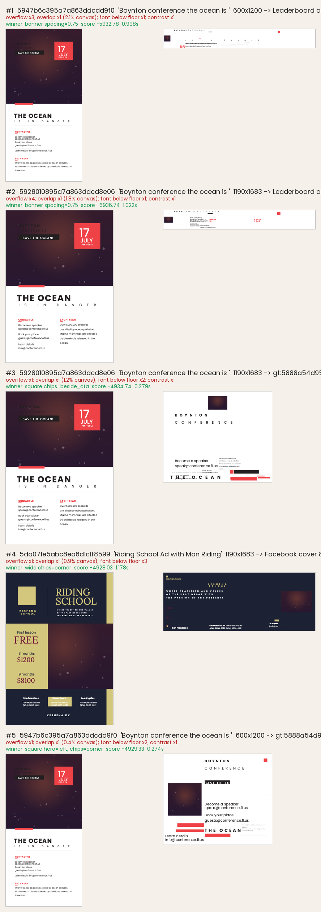
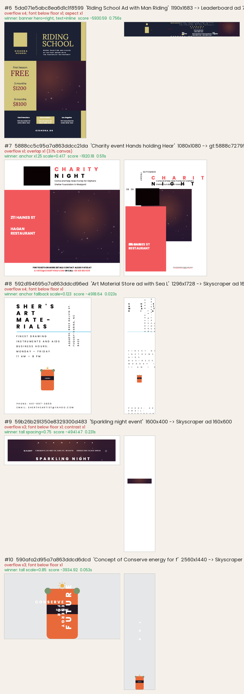
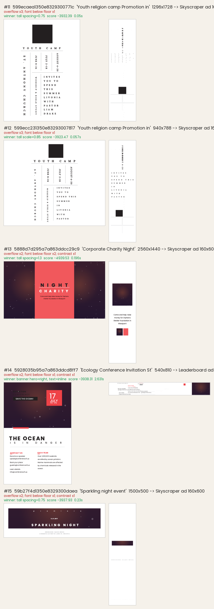
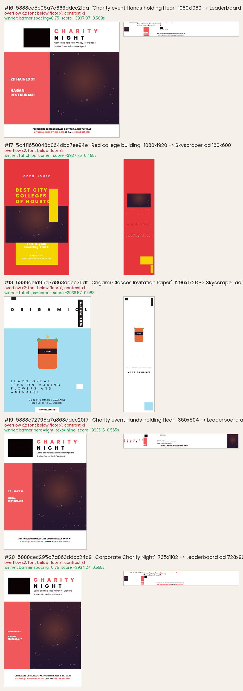
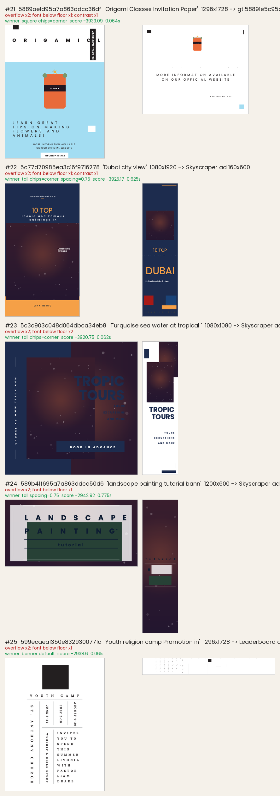
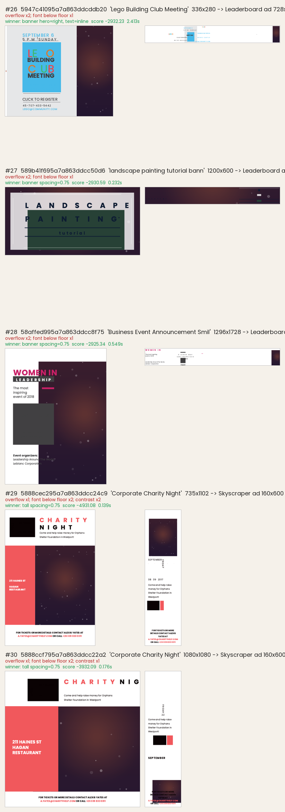

# EVAL v1 — the judge_v1 engine on real Crello designs

Generated 2026-10-20 by `eval/report.py` from run `full` (`eval/data/runs/full`).

Harness: `eval/crello_convert.py` (Crello -> schema v0.9, brand-kit stand-in assets), `eval/run_eval.py` (design x preset catalogue, metrics in `eval/metrics.py`), this report. See the CLAUDE.md note for how to run it.

Caveats: assets are the three Solstice stand-ins chosen by shape, fonts are Solstice Serif/Sans by serif-likeness, so *contrast* fails from the judge mostly reflect the substitution (white text that sat on a photo now sits on the white canvas) and are reported separately, not counted as defects. Everything else (ids, off-canvas, overflow, overlap, aspect, font floors) is measured exactly as the engine's own scorer measures it.

## Summary

Cases: **6058** (453 designs; 5436 preset cases, 608 ground-truth cases)

### Failure rate by metric

| metric | cases | rate |
|---|---:|---:|
| any_defect | 211 | 3.5% |
| error | 0 | 0.0% |
| ids | 0 | 0.0% |
| fields | 0 | 0.0% |
| offcanvas | 0 | 0.0% |
| aspect | 1 | 0.0% |
| overflow | 146 | 2.4% |
| below_floor | 137 | 2.3% |
| overlap | 11 | 0.2% |
| judge_hard | 820 | 13.5% |
| judge_contrast | 681 | 11.2% |
| fallback | 327 | 5.4% |

### By source ratio family

| group | n | any defect | off-canvas | overflow | overlap | below floor | aspect | error | contrast (judge) | score mean | p50 s |
|---|---:|---:|---:|---:|---:|---:|---:|---:|---:|---:|---:|
| banner | 559 | 3.0% | 0.0% | 1.1% | 0.5% | 1.6% | 0.0% | 0.0% | 14.0% | -97.39 | 0.21 |
| square | 1491 | 2.8% | 0.0% | 1.9% | 0.1% | 2.1% | 0.0% | 0.0% | 9.7% | -64.47 | 0.47 |
| tall | 1865 | 5.5% | 0.0% | 4.1% | 0.3% | 3.6% | 0.1% | 0.0% | 10.2% | -134.29 | 0.42 |
| wide | 2143 | 2.3% | 0.0% | 1.6% | 0.0% | 1.3% | 0.0% | 0.0% | 12.5% | -77.90 | 0.42 |

### By target family

| group | n | any defect | off-canvas | overflow | overlap | below floor | aspect | error | contrast (judge) | score mean | p50 s |
|---|---:|---:|---:|---:|---:|---:|---:|---:|---:|---:|---:|
| banner | 1402 | 4.2% | 0.0% | 3.4% | 0.4% | 3.0% | 0.1% | 0.0% | 13.7% | -145.19 | 0.41 |
| square | 588 | 1.9% | 0.0% | 1.2% | 0.3% | 1.2% | 0.0% | 0.0% | 8.7% | -36.58 | 0.45 |
| tall | 2462 | 4.1% | 0.0% | 2.7% | 0.0% | 2.8% | 0.0% | 0.0% | 10.4% | -94.44 | 0.45 |
| wide | 1606 | 2.6% | 0.0% | 1.6% | 0.1% | 1.2% | 0.0% | 0.0% | 11.3% | -68.74 | 0.36 |

### By source -> target family

| group | n | any defect | off-canvas | overflow | overlap | below floor | aspect | error | contrast (judge) | score mean | p50 s |
|---|---:|---:|---:|---:|---:|---:|---:|---:|---:|---:|---:|
| banner->banner | 133 | 4.5% | 0.0% | 1.5% | 2.3% | 0.8% | 0.0% | 0.0% | 12.0% | -89.61 | 0.23 |
| banner->square | 53 | 1.9% | 0.0% | 1.9% | 0.0% | 0.0% | 0.0% | 0.0% | 17.0% | -107.01 | 0.36 |
| banner->tall | 230 | 3.5% | 0.0% | 0.4% | 0.0% | 3.5% | 0.0% | 0.0% | 14.8% | -120.45 | 0.20 |
| banner->wide | 143 | 1.4% | 0.0% | 1.4% | 0.0% | 0.0% | 0.0% | 0.0% | 13.3% | -63.98 | 0.16 |
| square->banner | 349 | 3.4% | 0.0% | 3.2% | 0.0% | 3.2% | 0.0% | 0.0% | 12.0% | -111.43 | 0.51 |
| square->square | 139 | 0.7% | 0.0% | 0.0% | 0.0% | 0.7% | 0.0% | 0.0% | 6.5% | 14.96 | 0.41 |
| square->tall | 619 | 3.2% | 0.0% | 2.1% | 0.2% | 2.4% | 0.0% | 0.0% | 8.6% | -62.42 | 0.52 |
| square->wide | 384 | 2.3% | 0.0% | 1.0% | 0.0% | 1.3% | 0.0% | 0.0% | 10.7% | -53.85 | 0.39 |
| tall->banner | 432 | 7.6% | 0.0% | 6.2% | 0.7% | 5.6% | 0.2% | 0.0% | 17.1% | -273.85 | 0.49 |
| tall->square | 193 | 4.1% | 0.0% | 3.1% | 1.0% | 2.6% | 0.0% | 0.0% | 4.7% | -51.25 | 0.42 |
| tall->tall | 749 | 5.6% | 0.0% | 4.1% | 0.0% | 3.9% | 0.0% | 0.0% | 6.3% | -88.16 | 0.35 |
| tall->wide | 491 | 3.9% | 0.0% | 2.6% | 0.2% | 2.0% | 0.0% | 0.0% | 12.2% | -114.50 | 0.49 |
| wide->banner | 488 | 1.6% | 0.0% | 1.4% | 0.0% | 1.2% | 0.0% | 0.0% | 12.3% | -70.58 | 0.37 |
| wide->square | 203 | 0.5% | 0.0% | 0.0% | 0.0% | 0.5% | 0.0% | 0.0% | 11.8% | -39.55 | 0.50 |
| wide->tall | 864 | 3.5% | 0.0% | 2.4% | 0.0% | 2.0% | 0.0% | 0.0% | 14.2% | -115.89 | 0.58 |
| wide->wide | 588 | 1.9% | 0.0% | 1.2% | 0.2% | 0.7% | 0.0% | 0.0% | 10.4% | -41.40 | 0.26 |

### By preset

| group | n | any defect | off-canvas | overflow | overlap | below floor | aspect | error | contrast (judge) | score mean | p50 s |
|---|---:|---:|---:|---:|---:|---:|---:|---:|---:|---:|---:|
| A4 poster | 453 | 0.0% | 0.0% | 0.0% | 0.0% | 0.0% | 0.0% | 0.0% | 7.9% | 3.46 | 0.63 |
| Facebook cover | 453 | 4.6% | 0.0% | 2.0% | 0.4% | 3.1% | 0.0% | 0.0% | 13.0% | -120.70 | 0.27 |
| Instagram portrait | 453 | 0.4% | 0.0% | 0.4% | 0.0% | 0.2% | 0.0% | 0.0% | 7.5% | 2.55 | 0.50 |
| Instagram post | 453 | 0.7% | 0.0% | 0.4% | 0.0% | 0.2% | 0.0% | 0.0% | 7.3% | 2.94 | 0.49 |
| Leaderboard ad | 453 | 9.9% | 0.0% | 8.2% | 0.9% | 7.7% | 0.2% | 0.0% | 16.3% | -301.59 | 0.25 |
| LinkedIn banner | 453 | 1.3% | 0.0% | 0.9% | 0.2% | 0.7% | 0.0% | 0.0% | 12.4% | -66.54 | 0.50 |
| Pinterest pin | 453 | 0.4% | 0.0% | 0.4% | 0.0% | 0.2% | 0.0% | 0.0% | 9.1% | -13.76 | 0.50 |
| Skyscraper ad | 453 | 18.8% | 0.0% | 11.9% | 0.0% | 13.5% | 0.0% | 0.0% | 17.7% | -442.27 | 0.25 |
| Story / Reel | 453 | 0.2% | 0.0% | 0.2% | 0.0% | 0.2% | 0.0% | 0.0% | 9.1% | -12.48 | 0.67 |
| Twitter / X post | 453 | 0.7% | 0.0% | 0.7% | 0.0% | 0.0% | 0.0% | 0.0% | 8.6% | -11.20 | 0.46 |
| Wide web banner | 453 | 1.3% | 0.0% | 0.9% | 0.2% | 0.7% | 0.0% | 0.0% | 12.1% | -64.30 | 0.50 |
| YouTube thumbnail | 453 | 1.5% | 0.0% | 1.1% | 0.0% | 0.7% | 0.0% | 0.0% | 8.8% | -30.91 | 0.41 |
| gt (designer siblings) | 622 | 4.8% | 0.0% | 3.7% | 0.5% | 2.3% | 0.0% | 0.0% | 15.0% | -144.89 | 0.35 |

### Runtime per case (s)

| p50 | p95 | max | mean |
|---:|---:|---:|---:|
| 0.42 | 1.90 | 9.94 | 0.62 |

### Strategy share / winners

| strategy | share |
|---|---:|
| floorplan | 70.6% |
| anchor | 29.4% |

| winner | cases |
|---|---:|
| tall scale=1.15 | 515 |
| tall chips=corner | 383 |
| tall chips=corner, spacing=0.75 | 365 |
| banner text=inline, spacing=0.75 | 285 |
| banner text=inline | 250 |
| wide chips=corner | 228 |
| wide default | 217 |
| tall spacing=0.75 | 213 |
| banner spacing=0.75 | 206 |
| wide spacing=0.75 | 192 |
| banner scale=1.15 | 149 |
| wide scale=1.15 | 126 |
| wide hero=stack | 124 |
| square chips=corner | 124 |
| tall default | 118 |

### Judge score

| mean | p10 | p50 | p90 |
|---:|---:|---:|---:|
| -93.75 | -919.91 | 82.35 | 89.86 |

| component | mean (0-1) |
|---|---:|
| faith.anchors | 0.60 |
| faith.hierarchy | 0.98 |
| faith.order | 0.81 |
| faith.scale | 0.65 |
| layout.alignment | 0.66 |
| layout.balance | 0.90 |
| layout.fill | 0.91 |
| layout.margins | 0.88 |
| layout.spacing | 0.70 |
| read.contrast | 0.69 |
| read.lines | 0.96 |
| read.presence | 0.86 |
| read.size | 0.88 |

### Judge hard fails (winner), most common

| message (normalised) | cases |
|---|---:|
| <el> unreadable contrast N | 687 |
| <el> text overflows its box | 198 |
| <el> cta font N below readable N | 99 |
| <el> headline font N below readable N | 70 |
| <el> collides with <el> (Npx²) | 11 |
| <el> image aspect drifted N% | 1 |

Smallest font in the output: p05 = 6.00px, p50 = 24.00px

### Ground truth (designer's own version at the target size)

| metric | value |
|---|---:|
| n_cases | 608 |
| matched_text_mean | 3.46 |
| pos_err_mean | 0.15 |
| pos_err_p50 | 0.15 |
| order_tau_mean | 0.82 |
| order_tau_share_ge_0.5 | 0.72 |
| size_rho_mean | 0.78 |
| font_ratio_p50 | 0.99 |
| width_ratio_p50 | 1.55 |

## Automatically detected patterns

- Defect types by frequency: judge_contrast 11.2%, overflow 2.4%, below_floor 2.3%, overlap 0.2%, aspect 0.0%, error 0.0%.
- Hardest source -> target families: tall->banner (8% with a defect, n=432), tall->tall (6% with a defect, n=749), banner->banner (5% with a defect, n=133), tall->square (4% with a defect, n=193).
- Hardest presets: Skyscraper ad (19%), Leaderboard ad (10%), gt (designer siblings) (5%), Facebook cover (5%).
- Defect rate by winning strategy: anchor 2.6% (n=1780), floorplan 3.8% (n=4278).
- Text overflow: 146 cases; in 131 of them the smallest font is already <= 10px (the fitter hit its floor), the rest overflow at a comfortable size (box too small for the wrapped text, e.g. a single over-wide word or a hard line break).
- Unwanted overlap: 11 cases (8 floor-plan winners, 3 anchor winners); median overlap area 1.77% of the canvas.
- Weakest judge components on average: faith.anchors 0.60, faith.scale 0.65, layout.alignment 0.66.
- Against the designers' own versions (608 cases): mean centre error 0.154 of the diagonal, reading-order tau 0.82, size-hierarchy rho 0.78, our type is 0.99x theirs (median, canvas-normalised), our text boxes 1.55x as wide.

## Worst 30 cases

Contact sheets (source left, our output right): [worst_01-05.png](eval_v1/worst_01-05.png), [worst_06-10.png](eval_v1/worst_06-10.png), [worst_11-15.png](eval_v1/worst_11-15.png), [worst_16-20.png](eval_v1/worst_16-20.png), [worst_21-25.png](eval_v1/worst_21-25.png), [worst_26-30.png](eval_v1/worst_26-30.png)

| # | design | source | target | defects | winner | score |
|---:|---|---|---|---|---|---:|
| 1 | `5947b6c395a7a863ddcdd9f0` Boynton conference the ocean i | 600x1200 | Leaderboard ad 728x90 | overflow x3; overlap x1 (2.1% canvas); font below floor x1; contrast x1 | banner spacing=0.75 | -5932.78 |
| 2 | `5928010895a7a863ddcd8e06` Boynton conference the ocean i | 1190x1683 | Leaderboard ad 728x90 | overflow x4; overlap x1 (1.8% canvas); font below floor x1; contrast x1 | banner spacing=0.75 | -6936.74 |
| 3 | `5928010895a7a863ddcd8e06` Boynton conference the ocean i | 1190x1683 | gt:5888a54d95a7a863ddcc1d0c 300x250 | overflow x1; overlap x1 (1.2% canvas); font below floor x2; contrast x1 | square chips=beside_cta | -4934.74 |
| 4 | `5da071e5abc8ea6d1c1f8599` Riding School Ad with Man Ridi | 1190x1683 | Facebook cover 820x312 | overflow x1; overlap x1 (0.9% canvas); font below floor x3 | wide chips=corner | -4928.03 |
| 5 | `5947b6c395a7a863ddcdd9f0` Boynton conference the ocean i | 600x1200 | gt:5888a54d95a7a863ddcc1d0c 300x250 | overflow x1; overlap x1 (0.4% canvas); font below floor x2; contrast x1 | square hero=left, chips=corner | -4929.33 |
| 6 | `5da071e5abc8ea6d1c1f8599` Riding School Ad with Man Ridi | 1190x1683 | Leaderboard ad 728x90 | overflow x4; font below floor x1; aspect x1 | banner hero=right, text=inline | -5930.59 |
| 7 | `5888cc5c95a7a863ddcc21da` Charity event Hands holding He | 1080x1080 | gt:5888c72795a7a863ddcc20f7 360x504 | overflow x1; overlap x1 (3.1% canvas) | anchor x1.25 scale=0.417 | -1920.18 |
| 8 | `592d194695a7a863ddcd96ed` Art Material Store ad with Sea | 1296x1728 | Skyscraper ad 160x600 | overflow x4; font below floor x1 | anchor fallback scale=0.123 | -4918.64 |
| 9 | `59b26b291350e8329300d483` Sparkling night event | 1600x400 | Skyscraper ad 160x600 | overflow x3; font below floor x1; contrast x1 | tall spacing=0.75 | -4941.47 |
| 10 | `590afa2d95a7a863ddcd6dcd` Concept of Conserve energy for | 2560x1440 | Skyscraper ad 160x600 | overflow x3; font below floor x1 | tall scale=0.85 | -3934.92 |
| 11 | `599ecaea1350e8329300771c` Youth religion camp Promotion  | 1296x1728 | Skyscraper ad 160x600 | overflow x3; font below floor x1 | tall spacing=0.75 | -3932.39 |
| 12 | `599ecc231350e83293007817` Youth religion camp Promotion  | 940x788 | Skyscraper ad 160x600 | overflow x3; font below floor x1 | tall scale=0.85 | -3923.47 |
| 13 | `5888d7d295a7a863ddcc29c9` Corporate Charity Night | 2560x1440 | Skyscraper ad 160x600 | overflow x2; font below floor x2; contrast x1 | tall spacing=1.3 | -4939.53 |
| 14 | `5928035b95a7a863ddcd8ff7` Ecology Conference Invitation  | 540x810 | Leaderboard ad 728x90 | overflow x2; font below floor x1; contrast x1 | banner hero=right, text=inline | -3938.31 |
| 15 | `59b27f4d1350e8329300daea` Sparkling night event | 1500x500 | Skyscraper ad 160x600 | overflow x2; font below floor x1; contrast x1 | tall spacing=0.75 | -3937.93 |
| 16 | `5888cc5c95a7a863ddcc21da` Charity event Hands holding He | 1080x1080 | Leaderboard ad 728x90 | overflow x2; font below floor x1; contrast x1 | banner spacing=0.75 | -3937.87 |
| 17 | `5c4f1650048d064dbc7ee94e` Red college building | 1080x1920 | Skyscraper ad 160x600 | overflow x2; font below floor x2 | tall chips=corner | -3937.75 |
| 18 | `5889ae1d95a7a863ddcc36df` Origami Classes Invitation Pap | 1296x1728 | Skyscraper ad 160x600 | overflow x2; font below floor x1; contrast x1 | tall chips=corner | -3936.57 |
| 19 | `5888c72795a7a863ddcc20f7` Charity event Hands holding He | 360x504 | Leaderboard ad 728x90 | overflow x2; font below floor x1; contrast x1 | banner hero=right, text=inline | -3935.15 |
| 20 | `5888cec295a7a863ddcc24c9` Corporate Charity Night | 735x1102 | Leaderboard ad 728x90 | overflow x2; font below floor x1; contrast x1 | banner spacing=0.75 | -3934.27 |
| 21 | `5889ae1d95a7a863ddcc36df` Origami Classes Invitation Pap | 1296x1728 | gt:58891e5c95a7a863ddcc2f4b 336x280 | overflow x2; font below floor x1; contrast x1 | square chips=corner | -3933.09 |
| 22 | `5c77d70985ea3c16f9716278` Dubai city view | 1080x1920 | Skyscraper ad 160x600 | overflow x2; font below floor x1; contrast x1 | tall chips=corner, spacing=0.75 | -3925.17 |
| 23 | `5c3c903c048d064dbca34eb8` Turquoise sea water at tropica | 1080x1080 | Skyscraper ad 160x600 | overflow x2; font below floor x2 | tall chips=corner | -3920.75 |
| 24 | `589b41f695a7a863ddcc50d6` landscape painting tutorial ba | 1200x600 | Skyscraper ad 160x600 | overflow x2; font below floor x1 | tall spacing=0.75 | -2942.92 |
| 25 | `599ecaea1350e8329300771c` Youth religion camp Promotion  | 1296x1728 | Leaderboard ad 728x90 | overflow x2; font below floor x1 | banner default | -2938.6 |
| 26 | `5947c41095a7a863ddcddb20` Lego Building Club Meeting | 336x280 | Leaderboard ad 728x90 | overflow x2; font below floor x1 | banner hero=right, text=inline | -2932.23 |
| 27 | `589b41f695a7a863ddcc50d6` landscape painting tutorial ba | 1200x600 | Leaderboard ad 728x90 | overflow x2; font below floor x1 | banner spacing=0.75 | -2930.59 |
| 28 | `58affed995a7a863ddcc8f75` Business Event Announcement Sm | 1296x1728 | Leaderboard ad 728x90 | overflow x2; font below floor x1 | banner spacing=0.75 | -2925.34 |
| 29 | `5888cec295a7a863ddcc24c9` Corporate Charity Night | 735x1102 | Skyscraper ad 160x600 | overflow x1; font below floor x2; contrast x2 | tall spacing=0.75 | -4931.08 |
| 30 | `5888ccf795a7a863ddcc22a2` Corporate Charity Night | 1080x1080 | Skyscraper ad 160x600 | overflow x1; font below floor x2; contrast x1 | tall spacing=0.75 | -3932.09 |

## Observations (hand-written, from the contact sheets and the per-case data)

### What holds up
- **Structure is solid.** 0 crashes, 0 id/field/immutable violations, 0 important units off canvas, 1 image
  aspect drift in 6058 cases. The uniform-scale safety net was never needed.
- **Nine of the twelve presets are nearly defect-free** (≤ 1.5 % of cases with a measurable hard defect;
  A4 poster 0 %, Story/Reel 0.2 %). The square / tall / wide social formats are in good shape.
- **Reading order and hierarchy survive.** Against the designers' own versions of the same template
  (608 cases): reading-order Kendall tau 0.82 (72 % of cases ≥ 0.5), font-size-hierarchy Spearman 0.78,
  our type scale is 0.99× the designer's (median, canvas-normalised).
- **Speed is fine.** 0.21 s median per case in a single process (0.42 s with 4 workers competing for
  the CPU), 1.9 s p95, 9.9 s worst (a 1080×1920 render-heavy case).

### Failure patterns, most important first

1. **Zero-size text boxes crash the official renderer (fixed in this session).** 23 cases (0.4 %, all
   728×90) ended with a text element at width 0 × height 0 (font 1 px). cr-renderer's `TextElement`
   model requires width/height > 0 and rejects the *whole* design, so the task would produce no PNG and
   score nothing. Guard added in `resize._finalize` (text boxes ≥ 1 px, kept on canvas) and a regression
   test (`tests/test_eval.py::test_no_zero_size_text_elements_reach_the_official_renderer`,
   fixture `tests/fixtures/zero_size_text_regression.json`). Root cause still open: the banner plan
   squeezes a short uppercase line that `analyze` labels CTA ("THE OCEAN", the real headline) to nothing.

2. **Letter spacing is not scaled with the font.** Of the 146 overflow cases, ~50 overflowing elements
   carry positive `letter_spacing`. The wrap ignores letter spacing (as the renderer does) but the fit
   check adds it to the line width; when the font shrinks the px spacing stays, so the line never fits
   and `fit_font_size` runs down to the floor (1 px fonts appear in the outputs). Crello uses letter
   spacing on 40 % of text layers, so hidden tasks will too. **Suggestion:** scale `letter_spacing`
   with the font (same factor as `font_size`); the schema treats it as a px value, not a fixed one.

3. **Rotated text is fitted as if upright.** Vertical labels (rotation ±90°) have narrow boxes; the fitter
   wraps the words into that narrow width and collapses the font. 18 overflowing elements, every one
   ends at the floor. **Suggestion:** fit rotated text in its own frame (swap width/height for
   |rotation| near 90°, use the rotated AABB only for collisions, which `rectify` already does).

4. **Colour panels are treated as chips.** Crello designs are built from flat colour rectangles
   (single-colour SVGs → `shape` here): split backgrounds, side bars, text panels. The floor plans
   size shapes as badge-like chips, so a half-canvas panel becomes a 30 px square and the text that
   sat on it lands on the bare canvas (see worst #13 "Corporate Charity Night", #15 "Red college",
   #10 "Eco-consciousness"). This is the biggest *visual* weakness; the hard metrics barely see it,
   the ground-truth centre error (0.15 of the diagonal, 0.18 for big ratio changes) does.
   **Suggestion:** in `analyze`, a shape that covers ≥ ~15 % of the canvas or spans an edge to edge is a
   *panel*, not a chip; panels may be stretched (flat colour has no aspect) and should be laid out
   like backgrounds/zones, carrying the text that overlapped them in the source.

5. **Tiny canvases: 160×600 and 728×90 are where the engine fails.** Skyscraper: 18.8 % of cases with a
   hard defect (11.9 % overflow, 13.5 % headline/CTA font below the readable floor); Leaderboard 9.9 %;
   Facebook cover 4.6 %. Causes in the data: a single word wider than the slot (`content` cannot be
   broken, 24 elements), headline slots ≤ 130 px wide on a 160 px canvas, CTA labels squeezed below
   12 px. The ground truth agrees the type is too small on banners: our banner fonts are 0.77× the
   designer's (median) while every other family is ≈ 1.0×. **Suggestions:** (a) size the headline slot
   from its longest word at the floor font before shrinking anything else; (b) on banners give the text
   column more of the width (designers' text boxes are 1.3–1.7× wider than ours relative to the
   canvas, `gt_width_ratio`); (c) let the headline take 2–3 lines on skyscrapers before dropping below
   the floor; (d) drop fine print / badges to their minimum first (prio already exists, the floor
   search still ends at k where the headline is below floor).

6. **The anchor safety net wins 5.4 % of the time (327 cases), and 213 of those were "clean".** Every
   real candidate had a hard fail (often only a contrast fail from the stand-in assets, but in 30 cases
   a layout defect) so the fallback, which merely slides things to their anchors, was returned. It is
   defect-free but unpolished: big empty areas, shrunken content (worst #7/#8 "Origami"). **Suggestion:**
   make the anchor-fit layout a first-class candidate for big ratio changes (rectified, scored like the
   others) and let the judge pick it on merit, or feed it through the floor-plan spacing pass.

7. **The judge barely separates candidates.** Runner-up gap median 0.78 points; in 57 % of cases the
   top two candidates are within 1 point. Soft components with the least spread dominate
   (`faith.hierarchy` 0.98, `layout.fill` 0.91, `layout.balance` 0.90); the discriminating ones are
   `faith.anchors` (0.42 on banners), `faith.scale`, `layout.spacing`, `layout.alignment` (0.66).
   **Suggestion:** calibrate the weights with perturbed negatives (DesignSense: shift 20–50 % / scale
   0.8–1.2× of ~70 % of the elements and label bad) — the harness has every output JSON to perturb.

8. **Contrast hard fails (11.2 %) are mostly the dataset, but they hide an engine gap.** 45 of 453
   designs fail contrast in ≥ 50 % of their cases: white text whose photo was replaced by a small
   stand-in or whose colour panel shrank to a chip. The engine never reacts: it cannot recolour, but
   it could keep text on the unit it sat on. **Suggestion:** record "text over image/panel" relations
   in `analyze` and preserve them in the plans (same fix as pattern 4).

9. **Tight source boxes shrink the type silently.** Crello sizes a text box as lines × font ×
   line-height; `textfit.fits()` wants ascent + descent, so 90 % of raw Crello boxes count as
   overflowing and the engine shrinks their fonts (run `full_rawboxes`: defect rate 4.0 % vs 3.5 %,
   but `read.size` 0.853 vs 0.881, median smallest font 22 px vs 24 px, p10 of font-scale-vs-canvas
   0.60). The converter now normalises boxes (`--raw-boxes` keeps them). If the hidden tasks are drawn
   tight, the engine will under-size type. **Suggestion:** accept the renderer's own convention in
   `fits()` (height ≥ lines × font × line_height) or always grow the box before shrinking the font.

10. **Render budget under load.** With 4 worker processes, 615 cases lost pixel checks because a render
    exceeded the 2.5 s budget (CPU contention); single-process runs never hit it. Harmless for the
    judges' single run, but the budget is a function of machine load, not of the design.

### Prioritised list for the next engine session
- P0 (done here) zero-size text guard; still find why the banner plan collapses a CTA-labelled headline.
- P1 scale `letter_spacing` with `font_size` (pattern 2).
- P1 fit rotated text in its own frame (pattern 3).
- P1 panels: large flat shapes become stretchable zones that carry their text (patterns 4, 8).
- P2 tiny canvases: longest-word-aware slot widths, wider text column on banners, more headline lines
  before dropping below the floor (pattern 5).
- P2 anchor-fit as a real candidate for big ratio changes; polish or retire the raw fallback (pattern 6).
- P3 judge calibration with perturbed negatives generated from `eval/data/runs/full/outputs/` (pattern 7).
- P3 `fits()` convention for tight boxes (pattern 9); render budget independent of load (pattern 10).

### Harness caveats
- Assets are stand-ins chosen by shape (photo → gradient panel, wide → logo, else bottle); illustrations
  become bottle stickers. Fonts are Solstice Serif/Sans by serif-likeness. Both change the look, not the
  geometry. The original fonts/types are in each design's sidecar.
- Crello has no `group_id`, so grouped units (buttons, badges) are only exercised by the three samples.
- Ground-truth siblings are matched by title + shared text; the designer's version is at a slightly
  different canvas (same family), so `gt_*` numbers are canvas-normalised and approximate.

