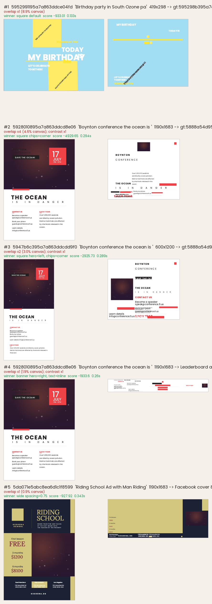
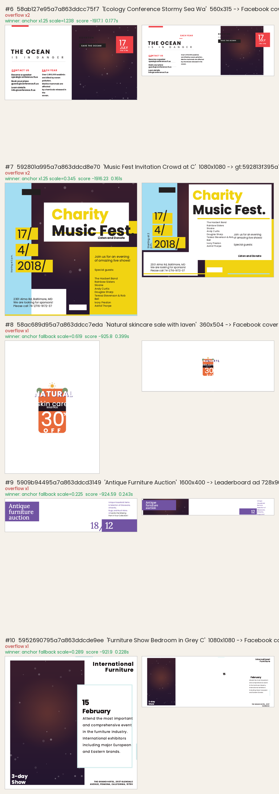
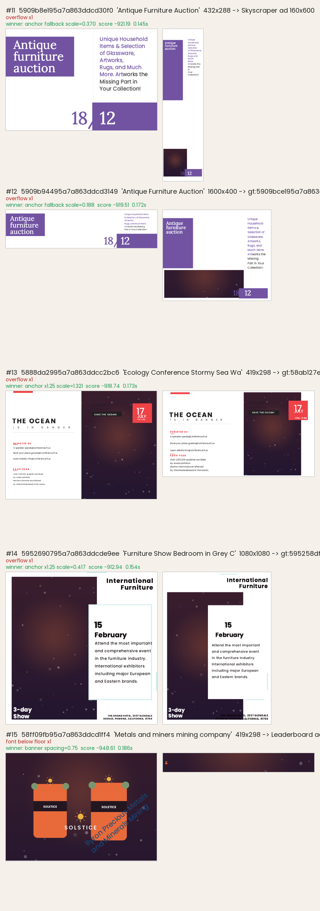
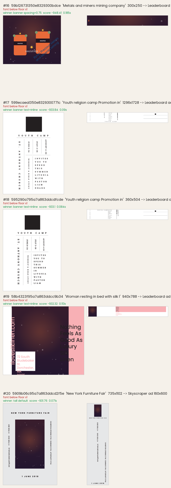
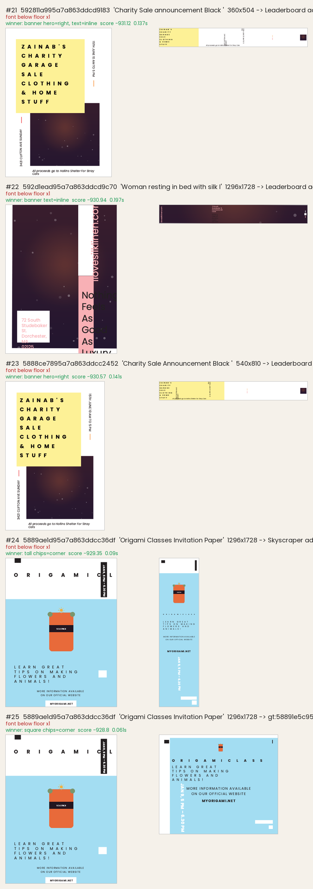
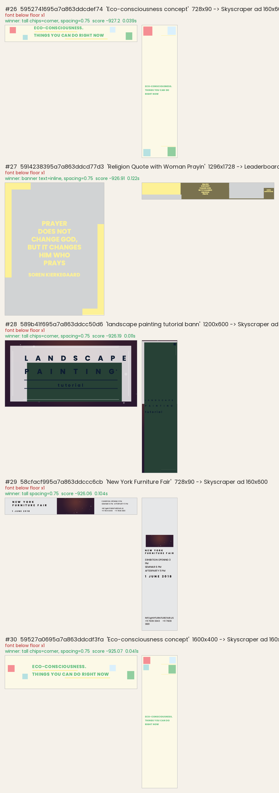

# EVAL v1 — the judge_v1 engine on real Crello designs

Generated 2026-10-21 by `eval/report.py` from run `v2` (`eval/data/runs/v2`).

Harness: `eval/crello_convert.py` (Crello -> schema v0.9, brand-kit stand-in assets), `eval/run_eval.py` (design x preset catalogue, metrics in `eval/metrics.py`), this report. See the CLAUDE.md note for how to run it.

Caveats: assets are the three Solstice stand-ins chosen by shape, fonts are Solstice Serif/Sans by serif-likeness, so *contrast* fails from the judge mostly reflect the substitution (white text that sat on a photo now sits on the white canvas) and are reported separately, not counted as defects. Everything else (ids, off-canvas, overflow, overlap, aspect, font floors) is measured exactly as the engine's own scorer measures it.

## Summary

Cases: **6058** (453 designs; 5436 preset cases, 608 ground-truth cases)

### Failure rate by metric

| metric | cases | rate |
|---|---:|---:|
| any_defect | 52 | 0.9% |
| error | 0 | 0.0% |
| ids | 0 | 0.0% |
| fields | 0 | 0.0% |
| offcanvas | 0 | 0.0% |
| aspect | 0 | 0.0% |
| overflow | 10 | 0.2% |
| below_floor | 36 | 0.6% |
| overlap | 6 | 0.1% |
| judge_hard | 459 | 7.6% |
| judge_contrast | 411 | 6.8% |
| fallback | 178 | 2.9% |

### By source ratio family

| group | n | any defect | off-canvas | overflow | overlap | below floor | aspect | error | contrast (judge) | score mean | p50 s |
|---|---:|---:|---:|---:|---:|---:|---:|---:|---:|---:|---:|
| banner | 559 | 1.1% | 0.0% | 0.5% | 0.0% | 0.5% | 0.0% | 0.0% | 4.5% | 27.07 | 0.15 |
| square | 1491 | 0.9% | 0.0% | 0.2% | 0.0% | 0.7% | 0.0% | 0.0% | 5.8% | 16.02 | 0.30 |
| tall | 1865 | 1.0% | 0.0% | 0.1% | 0.3% | 0.7% | 0.0% | 0.0% | 6.0% | 10.65 | 0.29 |
| wide | 2143 | 0.6% | 0.0% | 0.1% | 0.0% | 0.4% | 0.0% | 0.0% | 8.8% | -10.77 | 0.29 |

### By target family

| group | n | any defect | off-canvas | overflow | overlap | below floor | aspect | error | contrast (judge) | score mean | p50 s |
|---|---:|---:|---:|---:|---:|---:|---:|---:|---:|---:|---:|
| banner | 1402 | 0.9% | 0.0% | 0.1% | 0.1% | 0.8% | 0.0% | 0.0% | 7.5% | -2.82 | 0.27 |
| square | 588 | 0.9% | 0.0% | 0.2% | 0.5% | 0.2% | 0.0% | 0.0% | 5.6% | 13.66 | 0.35 |
| tall | 2462 | 1.0% | 0.0% | 0.1% | 0.0% | 0.9% | 0.0% | 0.0% | 6.5% | 8.89 | 0.31 |
| wide | 1606 | 0.6% | 0.0% | 0.4% | 0.1% | 0.1% | 0.0% | 0.0% | 7.0% | 6.11 | 0.26 |

### By source -> target family

| group | n | any defect | off-canvas | overflow | overlap | below floor | aspect | error | contrast (judge) | score mean | p50 s |
|---|---:|---:|---:|---:|---:|---:|---:|---:|---:|---:|---:|
| banner->banner | 133 | 0.8% | 0.0% | 0.8% | 0.0% | 0.0% | 0.0% | 0.0% | 3.0% | 46.87 | 0.12 |
| banner->square | 53 | 1.9% | 0.0% | 1.9% | 0.0% | 0.0% | 0.0% | 0.0% | 5.7% | 6.95 | 0.17 |
| banner->tall | 230 | 1.3% | 0.0% | 0.0% | 0.0% | 1.3% | 0.0% | 0.0% | 3.9% | 28.37 | 0.18 |
| banner->wide | 143 | 0.7% | 0.0% | 0.7% | 0.0% | 0.0% | 0.0% | 0.0% | 6.3% | 14.01 | 0.15 |
| square->banner | 349 | 0.6% | 0.0% | 0.0% | 0.0% | 0.6% | 0.0% | 0.0% | 6.0% | 15.41 | 0.30 |
| square->square | 139 | 0.0% | 0.0% | 0.0% | 0.0% | 0.0% | 0.0% | 0.0% | 4.3% | 44.20 | 0.27 |
| square->tall | 619 | 1.5% | 0.0% | 0.2% | 0.0% | 1.3% | 0.0% | 0.0% | 5.2% | 17.63 | 0.34 |
| square->wide | 384 | 0.8% | 0.0% | 0.5% | 0.0% | 0.3% | 0.0% | 0.0% | 7.0% | 3.79 | 0.28 |
| tall->banner | 432 | 1.6% | 0.0% | 0.0% | 0.2% | 1.4% | 0.0% | 0.0% | 8.1% | -17.95 | 0.29 |
| tall->square | 193 | 1.6% | 0.0% | 0.0% | 1.0% | 0.5% | 0.0% | 0.0% | 4.1% | 6.89 | 0.34 |
| tall->tall | 749 | 0.8% | 0.0% | 0.0% | 0.0% | 0.8% | 0.0% | 0.0% | 4.5% | 32.44 | 0.26 |
| tall->wide | 491 | 0.6% | 0.0% | 0.2% | 0.4% | 0.0% | 0.0% | 0.0% | 7.1% | 4.04 | 0.33 |
| wide->banner | 488 | 0.6% | 0.0% | 0.0% | 0.0% | 0.6% | 0.0% | 0.0% | 9.2% | -16.00 | 0.27 |
| wide->square | 203 | 0.5% | 0.0% | 0.0% | 0.5% | 0.0% | 0.0% | 0.0% | 7.9% | 0.95 | 0.41 |
| wide->tall | 864 | 0.7% | 0.0% | 0.1% | 0.0% | 0.6% | 0.0% | 0.0% | 9.8% | -22.97 | 0.42 |
| wide->wide | 588 | 0.5% | 0.0% | 0.3% | 0.0% | 0.2% | 0.0% | 0.0% | 7.1% | 7.44 | 0.19 |

### By preset

| group | n | any defect | off-canvas | overflow | overlap | below floor | aspect | error | contrast (judge) | score mean | p50 s |
|---|---:|---:|---:|---:|---:|---:|---:|---:|---:|---:|---:|
| A4 poster | 453 | 0.0% | 0.0% | 0.0% | 0.0% | 0.0% | 0.0% | 0.0% | 5.3% | 31.03 | 0.42 |
| Facebook cover | 453 | 1.3% | 0.0% | 0.7% | 0.4% | 0.2% | 0.0% | 0.0% | 7.5% | -7.38 | 0.18 |
| Instagram portrait | 453 | 0.0% | 0.0% | 0.0% | 0.0% | 0.0% | 0.0% | 0.0% | 4.6% | 38.99 | 0.35 |
| Instagram post | 453 | 0.0% | 0.0% | 0.0% | 0.0% | 0.0% | 0.0% | 0.0% | 4.6% | 39.15 | 0.39 |
| Leaderboard ad | 453 | 2.9% | 0.0% | 0.2% | 0.2% | 2.4% | 0.0% | 0.0% | 9.1% | -39.95 | 0.18 |
| LinkedIn banner | 453 | 0.0% | 0.0% | 0.0% | 0.0% | 0.0% | 0.0% | 0.0% | 6.8% | 14.03 | 0.35 |
| Pinterest pin | 453 | 0.0% | 0.0% | 0.0% | 0.0% | 0.0% | 0.0% | 0.0% | 5.5% | 29.27 | 0.35 |
| Skyscraper ad | 453 | 5.1% | 0.0% | 0.2% | 0.0% | 4.9% | 0.0% | 0.0% | 11.5% | -84.54 | 0.17 |
| Story / Reel | 453 | 0.0% | 0.0% | 0.0% | 0.0% | 0.0% | 0.0% | 0.0% | 5.5% | 28.24 | 0.45 |
| Twitter / X post | 453 | 0.0% | 0.0% | 0.0% | 0.0% | 0.0% | 0.0% | 0.0% | 5.7% | 27.01 | 0.34 |
| Wide web banner | 453 | 0.0% | 0.0% | 0.0% | 0.0% | 0.0% | 0.0% | 0.0% | 6.6% | 16.21 | 0.37 |
| YouTube thumbnail | 453 | 0.0% | 0.0% | 0.0% | 0.0% | 0.0% | 0.0% | 0.0% | 6.0% | 24.98 | 0.28 |
| gt (designer siblings) | 622 | 1.6% | 0.0% | 0.8% | 0.5% | 0.3% | 0.0% | 0.0% | 8.7% | -27.69 | 0.25 |

### Runtime per case (s)

| p50 | p95 | max | mean |
|---:|---:|---:|---:|
| 0.28 | 0.85 | 7.62 | 0.35 |

### Strategy share / winners

| strategy | share |
|---|---:|
| floorplan | 72.8% |
| anchor | 27.2% |

| winner | cases |
|---|---:|
| tall scale=1.15 | 585 |
| tall chips=corner, spacing=0.75 | 354 |
| tall chips=corner | 327 |
| banner text=inline, spacing=0.75 | 307 |
| banner text=inline | 269 |
| tall spacing=0.75 | 228 |
| wide spacing=0.75 | 224 |
| wide chips=corner | 222 |
| banner spacing=0.75 | 221 |
| wide default | 218 |
| banner scale=1.15 | 137 |
| tall default | 132 |
| wide hero=stack | 122 |
| wide scale=1.15 | 117 |
| banner hero=right, text=inline | 111 |

### Judge score

| mean | p10 | p50 | p90 |
|---:|---:|---:|---:|
| 5.91 | 70.62 | 83.62 | 91.02 |

| component | mean (0-1) |
|---|---:|
| faith.anchors | 0.60 |
| faith.hierarchy | 0.99 |
| faith.order | 0.82 |
| faith.scale | 0.70 |
| layout.alignment | 0.66 |
| layout.balance | 0.90 |
| layout.fill | 0.93 |
| layout.margins | 0.88 |
| layout.spacing | 0.73 |
| read.contrast | 0.74 |
| read.lines | 0.96 |
| read.presence | 0.86 |
| read.size | 0.88 |

### Judge hard fails (winner), most common

| message (normalised) | cases |
|---|---:|
| <el> unreadable contrast N | 411 |
| <el> headline font N below readable N | 31 |
| <el> text overflows its box | 12 |
| <el> collides with <el> (Npx²) | 10 |
| <el> cta font N below readable N | 5 |

Smallest font in the output: p05 = 7.00px, p50 = 24.00px

### Ground truth (designer's own version at the target size)

| metric | value |
|---|---:|
| n_cases | 608 |
| matched_text_mean | 3.46 |
| pos_err_mean | 0.15 |
| pos_err_p50 | 0.15 |
| order_tau_mean | 0.80 |
| order_tau_share_ge_0.5 | 0.72 |
| size_rho_mean | 0.80 |
| font_ratio_p50 | 0.98 |
| width_ratio_p50 | 1.50 |

## Automatically detected patterns

- Defect types by frequency: judge_contrast 6.8%, below_floor 0.6%, overflow 0.2%, overlap 0.1%, error 0.0%, ids 0.0%.
- Hardest source -> target families: banner->square (2% with a defect, n=53), tall->banner (2% with a defect, n=432), tall->square (2% with a defect, n=193), square->tall (1% with a defect, n=619).
- Hardest presets: Skyscraper ad (5%), Leaderboard ad (3%), gt (designer siblings) (2%), Facebook cover (1%).
- Defect rate by winning strategy: anchor 0.9% (n=1647), floorplan 0.9% (n=4411).
- Text overflow: 10 cases; in 10 of them the smallest font is already <= 10px (the fitter hit its floor), the rest overflow at a comfortable size (box too small for the wrapped text, e.g. a single over-wide word or a hard line break).
- Unwanted overlap: 6 cases (6 floor-plan winners, 0 anchor winners); median overlap area 3.04% of the canvas.
- Weakest judge components on average: faith.anchors 0.60, layout.alignment 0.66, faith.scale 0.70.
- Against the designers' own versions (608 cases): mean centre error 0.153 of the diagonal, reading-order tau 0.80, size-hierarchy rho 0.80, our type is 0.98x theirs (median, canvas-normalised), our text boxes 1.50x as wide.

## Worst 30 cases

Contact sheets (source left, our output right): [worst_01-05.png](eval_v2/worst_01-05.png), [worst_06-10.png](eval_v2/worst_06-10.png), [worst_11-15.png](eval_v2/worst_11-15.png), [worst_16-20.png](eval_v2/worst_16-20.png), [worst_21-25.png](eval_v2/worst_21-25.png), [worst_26-30.png](eval_v2/worst_26-30.png)

| # | design | source | target | defects | winner | score |
|---:|---|---|---|---|---|---:|
| 1 | `5952991195a7a863ddce04fd` Birthday party in South Ozone  | 419x298 | gt:595298b395a7a863ddce0480 336x280 | overlap x1 (8.9% canvas) | square default | -933.01 |
| 2 | `5928010895a7a863ddcd8e06` Boynton conference the ocean i | 1190x1683 | gt:5888a54d95a7a863ddcc1d0c 300x250 | overlap x4 (4.6% canvas); contrast x1 | square chips=corner | -4929.65 |
| 3 | `5947b6c395a7a863ddcdd9f0` Boynton conference the ocean i | 600x1200 | gt:5888a54d95a7a863ddcc1d0c 300x250 | overlap x2 (3.0% canvas); contrast x1 | square hero=left, chips=corner | -2925.73 |
| 4 | `5928010895a7a863ddcd8e06` Boynton conference the ocean i | 1190x1683 | Leaderboard ad 728x90 | overlap x1 (1.9% canvas); contrast x1 | banner hero=right, text=inline | -1933.6 |
| 5 | `5da071e5abc8ea6d1c1f8599` Riding School Ad with Man Ridi | 1190x1683 | Facebook cover 820x312 | overlap x1 (0.9% canvas) | wide spacing=0.75 | -927.92 |
| 6 | `58ab127e95a7a863ddcc75f7` Ecology Conference Stormy Sea  | 560x315 | Facebook cover 820x312 | overflow x2 | anchor x1.25 scale=1.238 | -1917.1 |
| 7 | `592801a995a7a863ddcd8e70` Music Fest Invitation Crowd at | 1080x1080 | gt:592813f395a7a863ddcd92ff 419x298 | overflow x2 | anchor x1.25 scale=0.345 | -1916.23 |
| 8 | `58ac689d95a7a863ddcc7eda` Natural skincare sale with lav | 360x504 | Facebook cover 820x312 | overflow x1 | anchor fallback scale=0.619 | -925.8 |
| 9 | `5909b94495a7a863ddcd3149` Antique Furniture Auction | 1600x400 | Leaderboard ad 728x90 | overflow x1 | anchor fallback scale=0.225 | -924.59 |
| 10 | `5952690795a7a863ddcde9ee` Furniture Show Bedroom in Grey | 1080x1080 | Facebook cover 820x312 | overflow x1 | anchor fallback scale=0.289 | -921.9 |
| 11 | `5909b8e195a7a863ddcd30f0` Antique Furniture Auction | 432x288 | Skyscraper ad 160x600 | overflow x1 | anchor fallback scale=0.370 | -921.19 |
| 12 | `5909b94495a7a863ddcd3149` Antique Furniture Auction | 1600x400 | gt:5909bce195a7a863ddcd341c 300x250 | overflow x1 | anchor fallback scale=0.188 | -919.51 |
| 13 | `5888da2995a7a863ddcc2bc6` Ecology Conference Stormy Sea  | 419x298 | gt:58ab127e95a7a863ddcc75f7 560x315 | overflow x1 | anchor x1.25 scale=1.321 | -918.74 |
| 14 | `5952690795a7a863ddcde9ee` Furniture Show Bedroom in Grey | 1080x1080 | gt:595258df95a7a863ddcde4c8 360x504 | overflow x1 | anchor x1.25 scale=0.417 | -912.94 |
| 15 | `58ff09fb95a7a863ddcd1ff4` Metals and miners mining compa | 419x298 | Leaderboard ad 728x90 | font below floor x1 | banner spacing=0.75 | -948.61 |
| 16 | `59b126731350e8329300bdce` Metals and miners mining compa | 300x250 | Leaderboard ad 728x90 | font below floor x1 | banner spacing=0.75 | -948.41 |
| 17 | `599ecaea1350e8329300771c` Youth religion camp Promotion  | 1296x1728 | Leaderboard ad 728x90 | font below floor x1 | banner text=inline | -933.84 |
| 18 | `595290a795a7a863ddcdfcde` Youth religion camp Promotion  | 360x504 | Leaderboard ad 728x90 | font below floor x1 | banner text=inline | -933.1 |
| 19 | `58b4323f95a7a863ddcc9b34` Woman resting in bed with silk | 940x788 | Leaderboard ad 728x90 | font below floor x1 | banner text=inline | -932.32 |
| 20 | `5909b06c95a7a863ddcd2f5e` New York Furniture Fair | 735x1102 | Skyscraper ad 160x600 | font below floor x1 | tall default | -931.76 |
| 21 | `592811a995a7a863ddcd9183` Charity Sale announcement Blac | 360x504 | Leaderboard ad 728x90 | font below floor x1 | banner hero=right, text=inline | -931.12 |
| 22 | `592d1ead95a7a863ddcd9c70` Woman resting in bed with silk | 1296x1728 | Leaderboard ad 728x90 | font below floor x1 | banner text=inline | -930.94 |
| 23 | `5888ce7895a7a863ddcc2452` Charity Sale Announcement Blac | 540x810 | Leaderboard ad 728x90 | font below floor x1 | banner hero=right | -930.57 |
| 24 | `5889ae1d95a7a863ddcc36df` Origami Classes Invitation Pap | 1296x1728 | Skyscraper ad 160x600 | font below floor x1 | tall chips=corner | -929.35 |
| 25 | `5889ae1d95a7a863ddcc36df` Origami Classes Invitation Pap | 1296x1728 | gt:58891e5c95a7a863ddcc2f4b 336x280 | font below floor x1 | square chips=corner | -928.8 |
| 26 | `5952741695a7a863ddcdef74` Eco-consciousness concept | 728x90 | Skyscraper ad 160x600 | font below floor x1 | tall chips=corner, spacing=0.75 | -927.2 |
| 27 | `5914238395a7a863ddcd77d3` Religion Quote with Woman Pray | 1296x1728 | Leaderboard ad 728x90 | font below floor x1 | banner text=inline, spacing=0.75 | -926.91 |
| 28 | `589b41f695a7a863ddcc50d6` landscape painting tutorial ba | 1200x600 | Skyscraper ad 160x600 | font below floor x1 | tall chips=corner, spacing=0.75 | -926.19 |
| 29 | `58cfacf995a7a863ddccc6cb` New York Furniture Fair | 728x90 | Skyscraper ad 160x600 | font below floor x1 | tall spacing=0.75 | -926.06 |
| 30 | `59527a0695a7a863ddcdf3fa` Eco-consciousness concept | 1600x400 | Skyscraper ad 160x600 | font below floor x1 | tall chips=corner, spacing=0.75 | -925.07 |

## Observations (hand-written): v1 -> v2

Engine changes between the runs (all in `chameleon/engine/`, tests in `tests/test_p1_fixes.py`): letter
spacing scales with the font; rotated text is wrapped and fitted in its own frame; large flat shapes are
*panels* (zones rebuilt around the content they carried, never chips); the banner plan sizes every item
before judging the row (the 0x0 text box root cause); one free-text CTA per design; the rectifier's
overlap shrink is bounded in total. One harness fix: `eval/metrics.py` measures off-canvas by the drawn
(rotated) extent, as the engine's scorer now does.

### Before / after (same 6058 cases, same stand-in assets)

| metric | v1 | v2 |
|---|---:|---:|
| any hard defect | 3.5 % (211) | 0.9 % (52) |
| text overflow | 2.4 % (146) | 0.2 % (10) |
| headline/CTA below floor | 2.3 % (137) | 0.6 % (36) |
| unwanted overlap | 0.2 % (11) | 0.1 % (6) |
| judge contrast fail (stand-in sensitive) | 11.2 % (681) | 6.8 % (411) |
| anchor fallback wins | 5.4 % (327) | 2.9 % (178) |
| Skyscraper 160x600: defect / overflow / below floor | 18.8 / 11.9 / 13.5 % | 5.1 / 0.2 / 4.9 % |
| Leaderboard 728x90: defect / overflow / below floor | 9.9 / 8.2 / 7.7 % | 2.9 / 0.2 / 2.4 % |
| Facebook cover 820x312: defect | 4.6 % | 1.3 % |
| every other preset: defect | 0.2–1.5 % | 0.0 % |
| designer siblings (gt): defect | 4.8 % | 1.6 % |
| smallest font p05 | 6 px | 7 px |
| judge score mean (banner / square / tall / wide targets) | -145 / -37 / -94 / -69 | -3 / +14 / +9 / +6 |
| read.contrast / faith.scale / layout.spacing (0–1) | 0.69 / 0.65 / 0.70 | 0.74 / 0.70 / 0.73 |
| gt reading-order tau / size rho / font ratio | 0.82 / 0.78 / 0.99 | 0.80 / 0.80 / 0.98 |
| runtime p50 / p95 (4 workers) | 0.42 / 1.90 s | 0.28 / 0.85 s |

No regressions: no preset got worse on any hard metric; the three shipped samples pick the same winners
with the same scores as judge_v1 (`docs/p1_fixes/`). Reading-order tau against the designers' versions
slipped 0.82 -> 0.80 (panels are no longer "content" in the order metric, and vertical labels now sit where
their rotated extent is), within noise of the 608-case sample.

### What the panel change needed to get right (found by a first v2 pass)
A first pass wrapped panels around every text inside them and the contrast fails *rose* to 14 %: loosely
built Crello templates have white copy half over a white card, cards drawn *above* the text, and
full-canvas "backgrounds" at a high z. Two rules fixed it: a unit is carried by the topmost panel drawn
below it (z_index), and a text in (nearly) the panel's own colour (contrast < 1.5 against the fill) is
not carried. Panels also cut back from every unit they do not carry, so a stretched zone never hides the
hero or lands under the headline.

### What is left (the worst-30 list above)
- **Font below floor on the 160x600 / 728x90 formats** (36 cases, now the dominant defect): a long or
  multi-word headline that cannot wrap enough; a banner text column that still gets ≤ 36 % of the width.
  This is the P2 item from EVAL_V1 (longest-word-aware slots, wider banner text column, more headline
  lines before dropping below the floor).
- **Overflow in anchor winners** (10 cases): tight source boxes with a hard line break or a single long
  word; the anchor path scales the box and keeps the floor font. The `fits()` convention for tight boxes
  (EVAL_V1 P3) is the fix.
- **Overlaps** (6 cases, all designer-sibling targets of the "Boynton conference" family): twelve text
  elements on a 300x250 canvas; the plan runs out of room and the rectifier cannot move anything.
- The anchor fallback still wins 2.9 % of cases (P2: make it a real, rectified candidate).
- Panels that carried nothing keep their fractional geometry on big ratio changes (a divider at 60 %
  height stays at 60 %), which is a guess; nothing in the data measures it.
