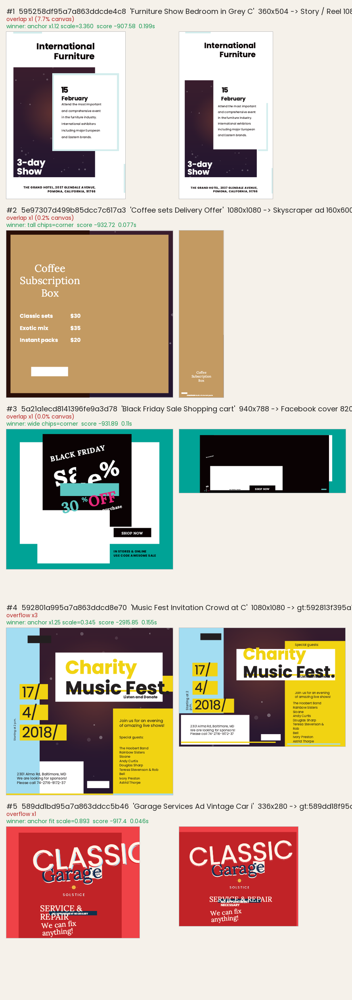
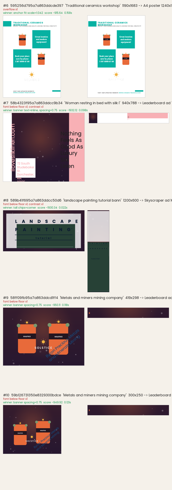
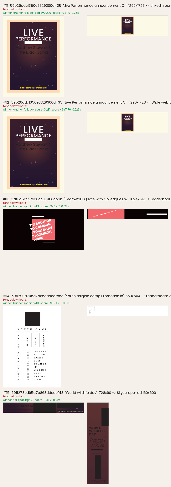
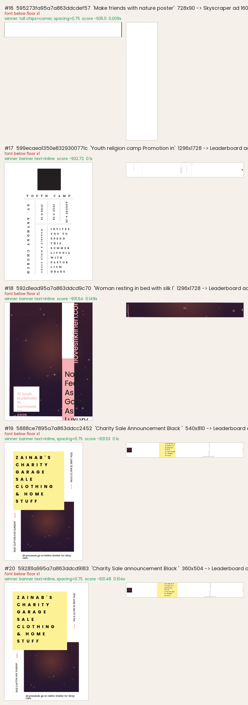
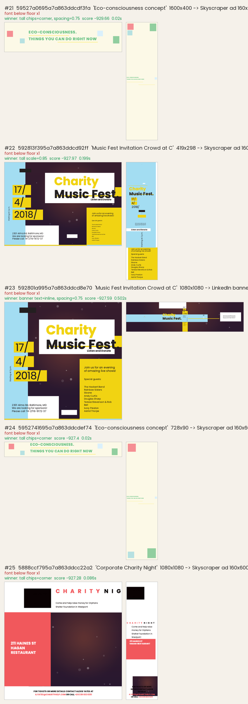
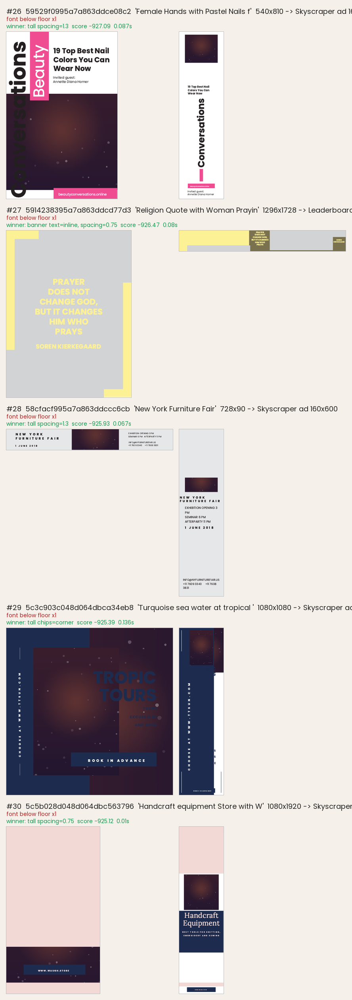

# EVAL v3 — the rule upgrades (contrast estimate, units beyond group_id, painted boxes and floors, source-relative penalties) on real Crello designs

Generated 2026-10-23 by `eval/report.py` from run `v3` (`eval/data/runs/v3`).

Harness: `eval/crello_convert.py` (Crello -> schema v0.9, brand-kit stand-in assets), `eval/run_eval.py` (design x preset catalogue, metrics in `eval/metrics.py`), this report. See the CLAUDE.md note for how to run it.

Caveats: assets are the three Solstice stand-ins chosen by shape, fonts are Solstice Serif/Sans by serif-likeness, so *contrast* fails from the judge mostly reflect the substitution (white text that sat on a photo now sits on the white canvas) and are reported separately, not counted as defects. Everything else (ids, off-canvas, overflow, overlap, aspect, font floors) is measured exactly as the engine's own scorer measures it.

## Summary

Cases: **6058** (453 designs; 5436 preset cases, 608 ground-truth cases)

### Failure rate by metric

| metric | cases | rate |
|---|---:|---:|
| any_defect | 40 | 0.7% |
| error | 0 | 0.0% |
| ids | 0 | 0.0% |
| fields | 0 | 0.0% |
| offcanvas | 0 | 0.0% |
| aspect | 0 | 0.0% |
| overflow | 3 | 0.0% |
| below_floor | 34 | 0.6% |
| overlap | 3 | 0.0% |
| judge_hard | 174 | 2.9% |
| judge_contrast | 136 | 2.2% |
| fallback | 43 | 0.7% |

### By source ratio family

| group | n | any defect | off-canvas | overflow | overlap | below floor | aspect | error | contrast (judge) | score mean | p50 s |
|---|---:|---:|---:|---:|---:|---:|---:|---:|---:|---:|---:|
| banner | 559 | 0.9% | 0.0% | 0.0% | 0.0% | 0.9% | 0.0% | 0.0% | 1.4% | 47.43 | 0.10 |
| square | 1491 | 0.9% | 0.0% | 0.1% | 0.1% | 0.7% | 0.0% | 0.0% | 1.7% | 54.32 | 0.18 |
| tall | 1865 | 0.8% | 0.0% | 0.1% | 0.1% | 0.7% | 0.0% | 0.0% | 1.9% | 52.91 | 0.18 |
| wide | 2143 | 0.3% | 0.0% | 0.0% | 0.0% | 0.3% | 0.0% | 0.0% | 3.1% | 48.42 | 0.18 |

### By target family

| group | n | any defect | off-canvas | overflow | overlap | below floor | aspect | error | contrast (judge) | score mean | p50 s |
|---|---:|---:|---:|---:|---:|---:|---:|---:|---:|---:|---:|
| banner | 1402 | 1.0% | 0.0% | 0.0% | 0.0% | 1.0% | 0.0% | 0.0% | 2.5% | 44.88 | 0.19 |
| square | 588 | 0.2% | 0.0% | 0.2% | 0.0% | 0.0% | 0.0% | 0.0% | 1.9% | 63.07 | 0.20 |
| tall | 2462 | 0.9% | 0.0% | 0.0% | 0.1% | 0.8% | 0.0% | 0.0% | 2.7% | 43.87 | 0.18 |
| wide | 1606 | 0.2% | 0.0% | 0.1% | 0.1% | 0.1% | 0.0% | 0.0% | 1.5% | 63.46 | 0.15 |

### By source -> target family

| group | n | any defect | off-canvas | overflow | overlap | below floor | aspect | error | contrast (judge) | score mean | p50 s |
|---|---:|---:|---:|---:|---:|---:|---:|---:|---:|---:|---:|
| banner->banner | 133 | 0.0% | 0.0% | 0.0% | 0.0% | 0.0% | 0.0% | 0.0% | 0.8% | 75.18 | 0.11 |
| banner->square | 53 | 0.0% | 0.0% | 0.0% | 0.0% | 0.0% | 0.0% | 0.0% | 1.9% | 60.50 | 0.14 |
| banner->tall | 230 | 2.2% | 0.0% | 0.0% | 0.0% | 2.2% | 0.0% | 0.0% | 2.6% | 7.68 | 0.09 |
| banner->wide | 143 | 0.0% | 0.0% | 0.0% | 0.0% | 0.0% | 0.0% | 0.0% | 0.0% | 80.69 | 0.11 |
| square->banner | 349 | 0.9% | 0.0% | 0.0% | 0.0% | 0.9% | 0.0% | 0.0% | 2.3% | 48.93 | 0.22 |
| square->square | 139 | 0.7% | 0.0% | 0.7% | 0.0% | 0.0% | 0.0% | 0.0% | 0.7% | 71.45 | 0.22 |
| square->tall | 619 | 1.3% | 0.0% | 0.0% | 0.2% | 1.1% | 0.0% | 0.0% | 2.1% | 48.86 | 0.17 |
| square->wide | 384 | 0.5% | 0.0% | 0.3% | 0.3% | 0.0% | 0.0% | 0.0% | 1.0% | 61.81 | 0.16 |
| tall->banner | 432 | 1.9% | 0.0% | 0.0% | 0.0% | 1.9% | 0.0% | 0.0% | 3.0% | 28.20 | 0.20 |
| tall->square | 193 | 0.0% | 0.0% | 0.0% | 0.0% | 0.0% | 0.0% | 0.0% | 0.5% | 78.25 | 0.20 |
| tall->tall | 749 | 0.8% | 0.0% | 0.1% | 0.1% | 0.5% | 0.0% | 0.0% | 1.2% | 63.13 | 0.18 |
| tall->wide | 491 | 0.2% | 0.0% | 0.0% | 0.0% | 0.2% | 0.0% | 0.0% | 2.6% | 49.09 | 0.16 |
| wide->banner | 488 | 0.6% | 0.0% | 0.0% | 0.0% | 0.6% | 0.0% | 0.0% | 2.7% | 48.49 | 0.18 |
| wide->square | 203 | 0.0% | 0.0% | 0.0% | 0.0% | 0.0% | 0.0% | 0.0% | 3.9% | 43.57 | 0.20 |
| wide->tall | 864 | 0.3% | 0.0% | 0.0% | 0.0% | 0.3% | 0.0% | 0.0% | 4.4% | 33.24 | 0.19 |
| wide->wide | 588 | 0.0% | 0.0% | 0.0% | 0.0% | 0.0% | 0.0% | 0.0% | 1.2% | 72.34 | 0.15 |

### By preset

| group | n | any defect | off-canvas | overflow | overlap | below floor | aspect | error | contrast (judge) | score mean | p50 s |
|---|---:|---:|---:|---:|---:|---:|---:|---:|---:|---:|---:|
| A4 poster | 453 | 0.2% | 0.0% | 0.2% | 0.0% | 0.0% | 0.0% | 0.0% | 2.0% | 58.77 | 0.24 |
| Facebook cover | 453 | 0.2% | 0.0% | 0.0% | 0.2% | 0.0% | 0.0% | 0.0% | 2.4% | 52.48 | 0.12 |
| Instagram portrait | 453 | 0.0% | 0.0% | 0.0% | 0.0% | 0.0% | 0.0% | 0.0% | 2.2% | 59.30 | 0.22 |
| Instagram post | 453 | 0.0% | 0.0% | 0.0% | 0.0% | 0.0% | 0.0% | 0.0% | 2.0% | 63.95 | 0.21 |
| Leaderboard ad | 453 | 2.4% | 0.0% | 0.0% | 0.0% | 2.4% | 0.0% | 0.0% | 3.8% | 15.05 | 0.15 |
| LinkedIn banner | 453 | 0.4% | 0.0% | 0.0% | 0.0% | 0.4% | 0.0% | 0.0% | 2.2% | 54.86 | 0.22 |
| Pinterest pin | 453 | 0.0% | 0.0% | 0.0% | 0.0% | 0.0% | 0.0% | 0.0% | 2.4% | 56.00 | 0.19 |
| Skyscraper ad | 453 | 4.4% | 0.0% | 0.0% | 0.2% | 4.2% | 0.0% | 0.0% | 4.2% | -10.93 | 0.09 |
| Story / Reel | 453 | 0.2% | 0.0% | 0.0% | 0.2% | 0.0% | 0.0% | 0.0% | 2.6% | 50.64 | 0.23 |
| Twitter / X post | 453 | 0.0% | 0.0% | 0.0% | 0.0% | 0.0% | 0.0% | 0.0% | 1.1% | 71.58 | 0.20 |
| Wide web banner | 453 | 0.2% | 0.0% | 0.0% | 0.0% | 0.2% | 0.0% | 0.0% | 1.8% | 61.40 | 0.22 |
| YouTube thumbnail | 453 | 0.0% | 0.0% | 0.0% | 0.0% | 0.0% | 0.0% | 0.0% | 1.1% | 71.57 | 0.18 |
| gt (designer siblings) | 622 | 0.5% | 0.0% | 0.3% | 0.0% | 0.2% | 0.0% | 0.0% | 1.6% | 57.91 | 0.15 |

### Runtime per case (s)

| p50 | p95 | max | mean |
|---:|---:|---:|---:|
| 0.17 | 0.43 | 6.28 | 0.20 |

### Strategy share / winners

| strategy | share |
|---|---:|
| floorplan | 70.0% |
| anchor | 30.0% |

| winner | cases |
|---|---:|
| tall scale=1.15 | 574 |
| tall chips=corner | 369 |
| banner text=inline, spacing=0.75 | 290 |
| wide chips=corner | 287 |
| banner text=inline | 274 |
| tall chips=corner, spacing=0.75 | 266 |
| tall spacing=0.75 | 177 |
| wide scale=1.15 | 157 |
| banner scale=1.15 | 153 |
| tall spacing=1.3 | 149 |
| banner spacing=0.75 | 126 |
| wide default | 119 |
| banner spacing=1.3 | 118 |
| banner hero=right, text=inline | 110 |
| banner default | 109 |

### Judge score

| mean | p10 | p50 | p90 |
|---:|---:|---:|---:|
| 51.16 | 72.21 | 82.45 | 89.52 |

| component | mean (0-1) |
|---|---:|
| faith.anchors | 0.60 |
| faith.hierarchy | 0.99 |
| faith.order | 0.84 |
| faith.scale | 0.74 |
| layout.alignment | 0.55 |
| layout.balance | 0.88 |
| layout.fill | 0.89 |
| layout.margins | 0.93 |
| layout.spacing | 0.70 |
| read.contrast | 0.69 |
| read.lines | 0.94 |
| read.presence | 0.86 |
| read.size | 0.89 |

### Judge hard fails (winner), most common

| message (normalised) | cases |
|---|---:|
| <el> unreadable contrast N (source N) | 144 |
| <el> headline font N below readable N | 21 |
| <el> cta font N below readable N | 13 |
| <el> text overflows its box | 5 |
| <el> collides with <el> (Npx²) | 3 |

Smallest font in the output: p05 = 6.00px, p50 = 24.00px

### Ground truth (designer's own version at the target size)

| metric | value |
|---|---:|
| n_cases | 608 |
| matched_text_mean | 3.46 |
| pos_err_mean | 0.15 |
| pos_err_p50 | 0.15 |
| order_tau_mean | 0.78 |
| order_tau_share_ge_0.5 | 0.70 |
| size_rho_mean | 0.78 |
| font_ratio_p50 | 1.00 |
| width_ratio_p50 | 1.25 |

## Automatically detected patterns

- Defect types by frequency: judge_contrast 2.2%, below_floor 0.6%, overflow 0.0%, overlap 0.0%, error 0.0%, ids 0.0%.
- Hardest source -> target families: banner->tall (2% with a defect, n=230), tall->banner (2% with a defect, n=432), square->tall (1% with a defect, n=619), square->banner (1% with a defect, n=349).
- Hardest presets: Skyscraper ad (4%), Leaderboard ad (2%), gt (designer siblings) (0%), LinkedIn banner (0%).
- Defect rate by winning strategy: anchor 0.4% (n=1818), floorplan 0.8% (n=4240).
- Text overflow: 3 cases; in 2 of them the smallest font is already <= 10px (the fitter hit its floor), the rest overflow at a comfortable size (box too small for the wrapped text, e.g. a single over-wide word or a hard line break).
- Unwanted overlap: 3 cases (2 floor-plan winners, 1 anchor winners); median overlap area 0.17% of the canvas.
- Weakest judge components on average: layout.alignment 0.55, faith.anchors 0.60, read.contrast 0.69.
- Against the designers' own versions (608 cases): mean centre error 0.152 of the diagonal, reading-order tau 0.78, size-hierarchy rho 0.78, our type is 1.00x theirs (median, canvas-normalised), our text boxes 1.25x as wide.

## Worst 30 cases

Contact sheets (source left, our output right): [worst_01-05.png](eval_v3/worst_01-05.png), [worst_06-10.png](eval_v3/worst_06-10.png), [worst_11-15.png](eval_v3/worst_11-15.png), [worst_16-20.png](eval_v3/worst_16-20.png), [worst_21-25.png](eval_v3/worst_21-25.png), [worst_26-30.png](eval_v3/worst_26-30.png)

| # | design | source | target | defects | winner | score |
|---:|---|---|---|---|---|---:|
| 1 | `595258df95a7a863ddcde4c8` Furniture Show Bedroom in Grey | 360x504 | Story / Reel 1080x1920 | overlap x1 (7.7% canvas) | anchor x1.12 scale=3.360 | -907.58 |
| 2 | `5e97307d499b85dcc7c617a3` Coffee sets Delivery Offer | 1080x1080 | Skyscraper ad 160x600 | overlap x1 (0.2% canvas) | tall chips=corner | -932.72 |
| 3 | `5a21a1ecd8141396fe9a3d78` Black Friday Sale Shopping car | 940x788 | Facebook cover 820x312 | overlap x1 (0.0% canvas) | wide chips=corner | -931.89 |
| 4 | `592801a995a7a863ddcd8e70` Music Fest Invitation Crowd at | 1080x1080 | gt:592813f395a7a863ddcd92ff 419x298 | overflow x3 | anchor x1.25 scale=0.345 | -2915.85 |
| 5 | `589dd1bd95a7a863ddcc5b46` Garage Services Ad Vintage Car | 336x280 | gt:589dd18f95a7a863ddcc5b34 300x250 | overflow x1 | anchor fit scale=0.893 | -917.4 |
| 6 | `595256d795a7a863ddcde397` Traditional ceramics workshop | 1190x1683 | A4 poster 1240x1754 | overflow x1 | anchor fit scale=1.042 | -915.64 |
| 7 | `58b4323f95a7a863ddcc9b34` Woman resting in bed with silk | 940x788 | Leaderboard ad 728x90 | font below floor x1; contrast x1 | banner text=inline, spacing=0.75 | -1932.12 |
| 8 | `589b41f695a7a863ddcc50d6` landscape painting tutorial ba | 1200x600 | Skyscraper ad 160x600 | font below floor x1; contrast x1 | tall chips=corner | -1930.34 |
| 9 | `58ff09fb95a7a863ddcd1ff4` Metals and miners mining compa | 419x298 | Leaderboard ad 728x90 | font below floor x1 | banner spacing=0.75 | -950.11 |
| 10 | `59b126731350e8329300bdce` Metals and miners mining compa | 300x250 | Leaderboard ad 728x90 | font below floor x1 | banner spacing=0.75 | -949.92 |
| 11 | `59b26adc1350e8329300d435` Live Performance announcement  | 1296x1728 | LinkedIn banner 1584x396 | font below floor x1 | anchor fallback scale=0.229 | -947.9 |
| 12 | `59b26adc1350e8329300d435` Live Performance announcement  | 1296x1728 | Wide web banner 1600x400 | font below floor x1 | anchor fallback scale=0.231 | -947.76 |
| 13 | `5df3a5a99fea0cc37408cbbb` Teamwork Quote with Colleagues | 1024x512 | Leaderboard ad 728x90 | font below floor x1 | banner spacing=1.3 | -942.47 |
| 14 | `595290a795a7a863ddcdfcde` Youth religion camp Promotion  | 360x504 | Leaderboard ad 728x90 | font below floor x1 | banner spacing=1.3 | -935.42 |
| 15 | `595273ed95a7a863ddcdef48` World wildlife day | 728x90 | Skyscraper ad 160x600 | font below floor x1 | tall spacing=1.3 | -935.2 |
| 16 | `595273fa95a7a863ddcdef57` Make friends with nature poste | 728x90 | Skyscraper ad 160x600 | font below floor x1 | tall chips=corner, spacing=0.75 | -935.11 |
| 17 | `599ecaea1350e8329300771c` Youth religion camp Promotion  | 1296x1728 | Leaderboard ad 728x90 | font below floor x1 | banner text=inline | -932.72 |
| 18 | `592d1ead95a7a863ddcd9c70` Woman resting in bed with silk | 1296x1728 | Leaderboard ad 728x90 | font below floor x1 | banner text=inline | -931.64 |
| 19 | `5888ce7895a7a863ddcc2452` Charity Sale Announcement Blac | 540x810 | Leaderboard ad 728x90 | font below floor x1 | banner text=inline, spacing=0.75 | -931.53 |
| 20 | `592811a995a7a863ddcd9183` Charity Sale announcement Blac | 360x504 | Leaderboard ad 728x90 | font below floor x1 | banner text=inline, spacing=0.75 | -931.48 |
| 21 | `59527a0695a7a863ddcdf3fa` Eco-consciousness concept | 1600x400 | Skyscraper ad 160x600 | font below floor x1 | tall chips=corner, spacing=0.75 | -929.66 |
| 22 | `592813f395a7a863ddcd92ff` Music Fest Invitation Crowd at | 419x298 | Skyscraper ad 160x600 | font below floor x1 | tall scale=0.85 | -927.97 |
| 23 | `592801a995a7a863ddcd8e70` Music Fest Invitation Crowd at | 1080x1080 | LinkedIn banner 1584x396 | font below floor x1 | banner text=inline, spacing=0.75 | -927.59 |
| 24 | `5952741695a7a863ddcdef74` Eco-consciousness concept | 728x90 | Skyscraper ad 160x600 | font below floor x1 | tall chips=corner | -927.4 |
| 25 | `5888ccf795a7a863ddcc22a2` Corporate Charity Night | 1080x1080 | Skyscraper ad 160x600 | font below floor x1 | tall chips=corner | -927.28 |
| 26 | `59529f0995a7a863ddce08c2` Female Hands with Pastel Nails | 540x810 | Skyscraper ad 160x600 | font below floor x1 | tall spacing=1.3 | -927.09 |
| 27 | `5914238395a7a863ddcd77d3` Religion Quote with Woman Pray | 1296x1728 | Leaderboard ad 728x90 | font below floor x1 | banner text=inline, spacing=0.75 | -926.47 |
| 28 | `58cfacf995a7a863ddccc6cb` New York Furniture Fair | 728x90 | Skyscraper ad 160x600 | font below floor x1 | tall spacing=1.3 | -925.93 |
| 29 | `5c3c903c048d064dbca34eb8` Turquoise sea water at tropica | 1080x1080 | Skyscraper ad 160x600 | font below floor x1 | tall chips=corner | -925.39 |
| 30 | `5c5b028d048d064dbc563796` Handcraft equipment Store with | 1080x1920 | Skyscraper ad 160x600 | font below floor x1 | tall spacing=0.75 | -925.12 |

## Observations (hand-written): v2 -> v3

Four rule upgrades borrowed from the rival engines (docs/COMPETITORS.md, "what to borrow" 1-5), all in
`chameleon/engine/`, tests in `tests/test_v3_rules.py` (19 tests) plus updated expectations in
`test_analyze.py`, `test_floorplan.py`, `test_judge.py`, `test_p1_fixes.py`.

1. **No-render contrast estimate** (`engine/contrast.py`, tailsgit). Layers under every text's painted box
   are composited from the JSON and the asset files at a 32x8 grid; the text's ratio is the 25th percentile
   of the WCAG ratios of its colour(s). Validation on 300 random v2 cases (1330 text elements, source and
   output of each, `eval/contrast_check.py`): Pearson 0.969 on log ratios, Spearman 0.973, verdict
   disagreement 3.2 % at 1.3:1, 1.9 % at 3:1, 2.4 % at 4.5:1; the hard-fail drop rule agrees on 97.9 % of
   the 376 headline / CTA elements (21 fails by estimate, 23 by render). The estimate is lower than the
   render-based number 70 % of the time (a 25th percentile against a mean colour). Cost: 1 ms per design
   against 69 ms for a text-less render. The judge now scores every candidate on the estimate and renders
   only the top 3 (`resize.TOP_RENDER`), which halves the runtime.
   The hard fail became *source-relative* (ratio < 3 and < 0.5x the same text's ratio in the source): with
   stand-in assets the old absolute rule flagged white copy that the source itself put on the white canvas.
2. **Units beyond group_id** (`engine/analyze.py`, tailsgit + gk7494): holders (label in a pill, sticker of
   short lines), photo frames, host bars attached to a heading, absorbed decorations, sibling rows. The
   Boynton poster (`5928010895a7a863ddcd8e06`, docs/sanity_v3/boynton_sheet.png) now keeps its underline
   bars under "CONTACT US" / "EACH YEAR", the divider under "IS IN DANGER" and the accent bar on the photo's
   edge in all twelve formats (`test_boynton_bars_stay_under_their_headings_in_every_format` checks the
   gap and the horizontal overlap per bar); the date block "17 / JULY / 1 PM - 6 PM" is one sticker and
   "THE OCEAN" is the headline (v2 took the 134 px "17" for it). Two lessons from the smoke runs: a shape
   holding *several* texts is a card, not a button (texts stayed readable in v2 because they were free;
   as a rigid group they shrank to 2-4 px), so only sticker-sized ones (<= 6 % of the canvas, short lines)
   merge and bigger ones become panels; and bars must be tested against the host element, not the growing
   cluster, or six far-away squares chain onto one headline.
3. **Painted text boxes and canvas-relative floors** (gk7494). Plans and the rectifier work on the glyph
   extent (`TextMeasurer.painted`), attachments keep their offset from it in font units; fonts never go
   below 0.85 % of the long side (legal 0.7x, badges 0.8x), logo / hero / stamps keep 14 / 30 / 8 % of the
   short side, the headline stays the largest text (`resize._keep_headline_largest`). Raising the floors
   exposed designs that only fit at sub-floor sizes (Level 3 on 160x600): v2 "fit" by letting the rectifier
   shrink the legal copy to 5 px; v3 has an explicit rescue mode that lowers secondary / minor floors by 0.45
   before a plan may overflow.
4. **Source-relative penalties and adaptation** (fernando-ace): overlap counts only when > 1.5 pp worse than
   the source pair (per part of a row), bleed the source had is excused, hierarchy keeps >= min(0.82, source
   ratio), a font is below the floor only if it also shrank versus the designer's size; the anchor layout on
   a ratio change >= 1.75 pays 18 points (`ADAPT_PENALTY`, so it wins only when every re-layout has a hard
   defect, which replaces the old "fallback only if all fail" sort trick), and a floor plan on a near-identity
   change pays up to 4 points (`DISRUPT_PENALTY`) so a finished design is not re-arranged for a 0.3-point
   judge preference.

### Measuring like for like
The metric definitions moved with the engine (painted boxes, per-part overlaps, higher floors, the drop
rule), so the published v2 numbers are not comparable with v3 as such. `eval/remeasure.py` re-judged the
v2 winner JSONs under the v3 metrics and scorer (run `v2_remeasured`); the tables below show v2 as
published, v2 re-measured and v3, on the same 6058 cases. The re-measured v2 overlap column is high (26 %) because v2 allowed *any* overlap between a pair
whose boxes touched in the source, and the Crello boxes touch far more often than the glyphs do; under
the "worse than the source pair" rule those are real overlaps (a stacked "mega / SHOES" lockup whose
overlap grew from 66 % to 90 %, a sticker that slid onto its photo), and v3's rectifier removes them
(0.05 % left).

### Before / after (same 6058 cases; v2 as published, v2 re-measured under the v3 rules, v3)

Common cases: **6058** (v2: 6058, v2_remeasured: 6058, v3: 6058)

| metric | v2 | v2_remeasured | v3 |
|---|---:|---:|---:|
| any hard defect (%) | 0.86 | 27.22 | 0.66 |
| any hard defect (n) | 52 | 1649 | 40 |
| text overflow (%) | 0.17 | 0.17 | 0.05 |
| text overflow (n) | 10 | 10 | 3 |
| headline/CTA below floor (%) | 0.59 | 2.72 | 0.56 |
| headline/CTA below floor (n) | 36 | 165 | 34 |
| unwanted overlap (%) | 0.10 | 26.23 | 0.05 |
| unwanted overlap (n) | 6 | 1589 | 3 |
| off canvas (%) | 0.00 | 0.00 | 0.00 |
| off canvas (n) | 0 | 0 | 0 |
| judge contrast fail (%) | 6.78 | 4.46 | 2.24 |
| judge contrast fail (n) | 411 | 270 | 136 |
| anchor fallback wins (%) | 2.94 | 2.94 | 0.71 |
| anchor fallback wins (n) | 178 | 178 | 43 |
| errors (%) | 0.00 | 0.00 | 0.00 |
| errors (n) | 0 | 0 | 0 |
| judge score mean | 5.91 | -737.62 | 51.16 |
| judge score p50 | 83.62 | 78.51 | 82.45 |
| read.size | 0.883 | 0.883 | 0.891 |
| read.lines | 0.958 | 0.935 | 0.936 |
| read.contrast | 0.744 | 0.696 | 0.693 |
| read.presence | 0.858 | 0.884 | 0.864 |
| layout.balance | 0.898 | 0.867 | 0.879 |
| layout.alignment | 0.657 | 0.553 | 0.550 |
| layout.spacing | 0.728 | 0.717 | 0.703 |
| layout.fill | 0.926 | 0.843 | 0.887 |
| layout.margins | 0.880 | 0.920 | 0.929 |
| faith.order | 0.822 | 0.831 | 0.840 |
| faith.anchors | 0.603 | 0.615 | 0.604 |
| faith.hierarchy | 0.991 | 0.988 | 0.985 |
| faith.scale | 0.698 | 0.690 | 0.737 |
| runtime p50 (s) | 0.28 | 0.28 | 0.17 |
| runtime p95 (s) | 0.85 | 0.85 | 0.43 |
| smallest font p05 (px) | 7.0 | 7.0 | 6.0 |
| gt centre error | 0.153 | 0.153 | 0.152 |
| gt reading-order tau | 0.805 | 0.805 | 0.781 |
| gt size rho | 0.801 | 0.801 | 0.784 |
| gt font ratio (median) | 0.983 | 0.983 | 1.000 |

### Defect rate by preset (%)

| preset | n | v2 any | v2_remeasured any | v3 any | v2 below floor | v2_remeasured below floor | v3 below floor | v2 overlap | v2_remeasured overlap | v3 overlap | v2 contrast | v2_remeasured contrast | v3 contrast |
|---|---:|---:|---:|---:|---:|---:|---:|---:|---:|---:|---:|---:|---:|
| A4 poster | 453 | 0.0 | 25.6 | 0.2 | 0.0 | 1.8 | 0.0 | 0.0 | 24.9 | 0.0 | 5.3 | 3.8 | 2.0 |
| Facebook cover | 453 | 1.3 | 28.7 | 0.2 | 0.2 | 2.9 | 0.0 | 0.4 | 28.5 | 0.2 | 7.5 | 4.4 | 2.4 |
| Instagram portrait | 453 | 0.0 | 30.2 | 0.0 | 0.0 | 0.2 | 0.0 | 0.0 | 30.0 | 0.0 | 4.6 | 3.3 | 2.2 |
| Instagram post | 453 | 0.0 | 28.7 | 0.0 | 0.0 | 0.2 | 0.0 | 0.0 | 28.7 | 0.0 | 4.6 | 3.1 | 2.0 |
| Leaderboard ad | 453 | 2.9 | 27.2 | 2.4 | 2.4 | 6.4 | 2.4 | 0.2 | 24.1 | 0.0 | 9.1 | 7.1 | 3.8 |
| LinkedIn banner | 453 | 0.0 | 24.3 | 0.4 | 0.0 | 4.9 | 0.4 | 0.0 | 23.4 | 0.0 | 6.8 | 5.3 | 2.2 |
| Pinterest pin | 453 | 0.0 | 25.8 | 0.0 | 0.0 | 1.8 | 0.0 | 0.0 | 25.2 | 0.0 | 5.5 | 3.3 | 2.4 |
| Skyscraper ad | 453 | 5.1 | 25.2 | 4.4 | 4.9 | 4.4 | 4.2 | 0.0 | 21.6 | 0.2 | 11.5 | 7.7 | 4.2 |
| Story / Reel | 453 | 0.0 | 23.6 | 0.2 | 0.0 | 2.2 | 0.0 | 0.0 | 22.7 | 0.2 | 5.5 | 4.0 | 2.6 |
| Twitter / X post | 453 | 0.0 | 32.0 | 0.0 | 0.0 | 2.2 | 0.0 | 0.0 | 30.9 | 0.0 | 5.7 | 3.3 | 1.1 |
| Wide web banner | 453 | 0.0 | 23.4 | 0.2 | 0.0 | 4.6 | 0.2 | 0.0 | 22.5 | 0.0 | 6.6 | 4.6 | 1.8 |
| YouTube thumbnail | 453 | 0.0 | 31.3 | 0.0 | 0.0 | 1.5 | 0.0 | 0.0 | 31.3 | 0.0 | 6.0 | 3.3 | 1.1 |
| gt (designer siblings) | 622 | 1.6 | 27.7 | 0.5 | 0.3 | 2.4 | 0.2 | 0.5 | 26.8 | 0.0 | 8.7 | 4.7 | 1.6 |

Reading of the table: every hard-defect metric improved (any defect 52 -> 40 cases, overflow 10 -> 3,
below floor 36 -> 34, overlap 6 -> 3 under the stricter rule, 1589 under that rule for the v2 outputs),
the judge's contrast fails fell 411 -> 136 (drop rule + the estimate seeing panels and assets), the anchor
fallback wins 178 -> 43 (it now competes with a penalty instead of being excluded), runtime halved (p50
0.28 -> 0.17 s, p95 0.85 -> 0.43 s: one render for the top 3 instead of one per candidate). Skyscraper
5.1 % -> 4.4 %, Leaderboard 2.9 % -> 2.4 %, Facebook cover 1.3 % -> 0.2 %, designer siblings 1.6 % -> 0.5 %.

What did not improve, against the re-measured v2 (same definitions): faith.hierarchy 0.988 -> 0.985,
faith.anchors 0.615 -> 0.604, read.presence 0.884 -> 0.864, layout.spacing 0.717 -> 0.703, and against
the designers' own versions reading-order tau 0.805 -> 0.781 and size rho 0.801 -> 0.784 (61 sibling
cases worse, 34 better; the largest drops are 2-3 matched texts where tau flips sign). The driver is the
anchor path winning more sibling cases (140 -> 186: `SMALL_CHANGE_MAX` 1.6 -> 1.75 and the disruption
penalty near identity), i.e. v3 keeps the designer's *source* arrangement where the designer's sibling
re-arranged. That is a deliberate trade (identity resizes stay the identity; fallback wins and defects
fell) and the deltas are within 0.02; it is flagged here rather than hidden. `read.contrast`,
`layout.alignment` and `layout.fill` moved between v2-published and v2-remeasured because their
definitions changed (25th-percentile estimate; visible boxes), not the layouts.

### Remaining defects (v3 worst cases, docs/eval_v3)
- 21 headline / 13 CTA fonts below the floor, almost all 160x600 and 728x90: an unbreakable single
  word (a URL in a pill: "beautyconversations.online", "WWW.WAUGH.STORE") wider than the canvas at
  the floor font; v2 labelled the same texts BODY (no floor), v3 labels the pill CTA. Nothing fits them.
- 144 contrast drops (not counted as defects, see caveat): white copy that sat on the photo and lands on
  the white canvas in a banner / tall plan. The panel system keeps text on *shapes*; text on a photo
  has no zone to follow it. Candidate for the next step: a "text stays on the hero" placement or a
  colour-aware check in the plans.
- 9 cases clean in v2 and defective in v3 (5 of them the URL pills above); 1618 the other way round under
  the stricter overlap rule.

